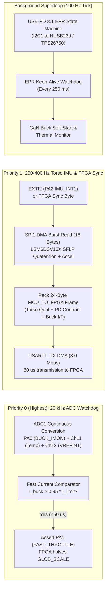

# Central Controller Housekeeping & Torso IMU MCU Architecture

**Component**: `U_MCU1` on `CentralController` PCB  
**Part Number**: Puya `PY32F003F18U6` (`32-bit ARM Cortex-M0+` @ $24–32\text{ MHz}$, $64\text{ kB}$ Flash, $8\text{ kB}$ SRAM, `QFN-20` $3\times 3\text{ mm}$)  
**Programming Interface**: 6-Pad `Tag-Connect TC2030-IDC-NL` (`J_SWD_CC`)  

---

## 1. Role of the Central Controller MCU (and Why `PY32F003F18U6` Replaced `ESP32-C5`)

Earlier architectural iterations considered an `ESP32-C5` on the Central Controller. However, because wireless communication and full-body 3D skeletal kinematics are handled by the high-performance Android Phone (connected via USB-C to the `FTDI FT2232H`), a bulky Wi-Fi SoC on the Central Controller was redundant.

Replacing the `ESP32-C5` with the exact same **$3\times 3\text{ mm}$ `PY32F003F18U6`** used on every `TriangleNode` and `IMUNode` achieves **100% MCU BOM and toolchain unification** across the entire project while providing dedicated, deterministic real-time hardware control for four critical Central Controller functions:

1. **Instant-On USB-PD 3.1 EPR Negotiation & Keep-Alive (`< 2 ms` Cold Boot)**:
   - Unlike the ECP5 FPGA (which takes $\sim 50–100\text{ ms}$ to load its bitstream from SPI Flash), the `PY32F003F18U6` wakes from internal HSI in **$< 1.5\text{ ms}$** as soon as a USB-PD power bank is plugged in.
   - It immediately configures the **`HUSB239` / `TPS26750` USB-PD 3.1 EPR Sink Controller** over `I2C1` to negotiate the highest available voltage/power contract ($20\text{V} @ 3.25\text{A} = 65\text{W}$ up to $48\text{V} @ 5\text{A} = 240\text{W}$ Extended Power Range) and maintains the mandatory USB-PD 3.1 EPR keep-alive watchdog.
2. **GaN Buck Current Monitoring & Fast Hardware Over-Current Protection (`BUCK_IMON`)**:
   - Continuously samples the analog current-sense output (`BUCK_IMON`) of the 3-phase **`TI LMG708B0` 48V-to-5V GaN Buck Stage** via its 12-bit hardware ADC (`PA0`) at $20\text{ kHz}$ ($50\,\mu\text{s}$ loop).
   - Provides a sub-100 µs hardware safety clamp (`FAST_THROTTLE` / `GLOBAL_LED_DE` override) if an anomalous surge ever threatens to trip the USB-PD power bank's internal over-current fuse.
3. **Torso Reference IMU Polling (`LSM6DSV16X` `U_IMU1`)**:
   - Polls the Central Controller's onboard **Torso Reference IMU (`LSM6DSV16X`)** over 4-wire `SPI1` (`PA4..PA7`) at **$200–400\text{ Hz}$**, running the exact same `lsm6dsv16x_spi.c` driver and `SFLP` quaternion fusion configuration as the 4 sleeve `IMUNode` boards.
   - Because the Central Controller is mounted rigidly to the wearer's chest/back torso, this 5th IMU provides the root coordinate frame ($\mathbf{q}_{\text{torso}}$) against which the 4 arm/wrist `IMUNode` quaternions are referenced!
4. **High-Speed Telemetry & Power Contract Bridge to FPGA**:
   - Streams a compact 24-byte status & quaternion frame to the ECP5 FPGA over `USART1` (`3.0 Mbps`) at **$200–400\text{ Hz}$**, delivering both the Torso IMU quaternion and the active power supply budget (`VBUS_MV`, `IBUS_MA`, `BUCK_IMON_MA`, `PCB_TEMP_C`) so the FPGA can update `GLOB_SCALE` and forward the full 5-IMU body pose to the Phone over USB.

---

## 2. Pinout & Peripheral Allocation (`U_MCU1` `PY32F003F18U6`)

```text
                       +------------------------------+
        I2C1_SDA / PB7 | 1                         20 | PB6 / I2C1_SCL (To HUSB239 / TPS26750)
  FPGA_UART_TX / PF0   | 2                         19 | PF4 / BOOT0 (10k to GND)
  FPGA_UART_RX / PF1   | 3                         18 | PF2 / NRST (To TC2030 J_SWD_CC)
       BUCK_IMON / PA0 | 4 (ADC_IN0)               17 | PA14 / SWCLK (To TC2030 J_SWD_CC)
   FAST_THROTTLE / PA1 | 5      PY32F003F18U6      16 | PA13 / SWDIO (To TC2030 J_SWD_CC)
        IMU_INT1 / PA2 | 6      (QFN-20 3x3mm)     15 | PA12 / EXT_5V_SENSE (External 800W Supply)
        PD_IRQ_N / PA3 | 7                         14 | PA7 / SPI1_MOSI (To Torso LSM6DSV16X)
                   GND | 8                         13 | PA6 / SPI1_MISO (From Torso LSM6DSV16X)
                 +3.3V | 9                         12 | PA5 / SPI1_SCK  (To Torso LSM6DSV16X)
        SPI1_NSS / PA4 | 10                        11 | PB5 / BUCK_EN   (GaN Buck Stage Enable)
                       +------------------------------+
```

| Pin | Signal Name | Peripheral | Connected Hardware | Function |
| :---: | :--- | :--- | :--- | :--- |
| `4` | `BUCK_IMON` | `ADC_IN0` (`PA0`) | `TI LMG708B0` GaN Buck Sense | $20\text{ kHz}$ DMA ADC current measurement of the $+5.0\text{V}$ LED rail ($0..200\text{A}$ range). |
| `5` | `FAST_THROTTLE` | `GPIO_Out` (`PA1`) | `Lattice ECP5` + `GLOBAL_LED_DE` | Asserted HIGH within $50\,\mu\text{s}$ if `BUCK_IMON` exceeds $95\%$ of negotiated PD limit. |
| `6` | `IMU_INT1` | `EXTI2` (`PA2`) | `LSM6DSV16X` (`U_IMU1` Pin 4) | Rising-edge interrupt when a new 200/400 Hz `SFLP` Quaternion is ready in IMU FIFO. |
| `7` | `PD_IRQ_N` | `EXTI3` (`PA3`) | `HUSB239` / `TPS26750` `INT#` | Active-low interrupt on USB-PD attach, detach, PDO contract change, or fault. |
| `10,12..14` | `IMU_SPI_*` | `SPI1` (`PA4..PA7`) | `LSM6DSV16X` (`U_IMU1`) | $8\text{ MHz}$ 4-wire Mode 3 SPI bus for reading Torso IMU quaternions and linear acceleration. |
| `11` | `BUCK_EN` | `GPIO_Out` (`PB5`) | `3x TI LMG708B0` Enable | Enables the high-power $+5\text{V}$ GaN buck stage only *after* USB-PD negotiation stabilizes. |
| `15` | `EXT_5V_SENSE` | `GPIO_In` (`PA12`) | External $+5\text{V}$ Stage Jack | Detects when an external high-current $+5\text{V}$ ($800\text{W}+$) supply is connected. |
| `1, 20` | `PD_I2C_*` | `I2C1` (`PB6/PB7`) | `HUSB239` / `TPS26750` | $400\text{ kHz}$ Fast-Mode I2C bus for USB-PD 3.1 EPR sink control & telemetry. |
| `2, 3` | `FPGA_UART_*` | `USART1` (`PF0/PF1`) | `Lattice ECP5` I/O Pins | $3.000\text{ Mbps}$ full-duplex UART link to the FPGA (`MCU_Telemetry_Bridge`). |
| `16..19` | `SWD / NRST` | `SWD` (`PA13/14, PF2/4`)| `Tag-Connect TC2030-IDC-NL` | Factory / developer pogo-pin programming and live debugging. |

---

## 3. Firmware Architecture ("All the Furniture Running on It")

The Central Controller `PY32F003` runs a deterministic, zero-RTOS bare-metal firmware structured around three hardware interrupt priorities and a cooperative background housekeeping loop:



### 3.1 Furniture Module 1: USB-PD 3.1 EPR Negotiation & Power Source Arbiter (`usb_pd_epr.c`)
1. **Cold-Boot Initialization (`t < 2 ms`)**:
   - The `PY32F003` is powered from the always-on $+3.3\text{V}$ auxiliary LDO generated directly by the USB-PD controller (`HUSB239` / `TPS26750`) as soon as a USB-C power cable is attached, *before* the main GaN buck stage is enabled (`BUCK_EN = 0`).
2. **PDO Evaluation & Contract Selection**:
   - Upon receiving `PD_IRQ_N` (Source Capabilities received), the MCU reads the advertised Source PDOs (Standard Power Range $5\text{V}..20\text{V}$) and EPR AVS/Fixed PDOs ($28\text{V}$, $36\text{V}$, $48\text{V}$ up to $5\text{A} = 240\text{W}$) over `I2C1`.
   - It selects the highest power profile supported by the attached brick:
     - **$240\text{W}$ EPR (`48V @ 5A`)** $\rightarrow$ `P_budget = 228W` continuous ($95\%$ buck efficiency $\implies 45.6\text{A}$ at $+5.0\text{V}$).
     - **$140\text{W}$ EPR (`28V @ 5A`)** $\rightarrow$ `P_budget = 133W` continuous ($26.6\text{A}$ at $+5.0\text{V}$).
     - **$100\text{W}$ SPR (`20V @ 5A`)** $\rightarrow$ `P_budget = 95W` continuous ($19.0\text{A}$ at $+5.0\text{V}$).
     - **$65\text{W}$ SPR (`20V @ 3.25A`)** $\rightarrow$ `P_budget = 61W` continuous ($12.2\text{A}$ at $+5.0\text{V}$).
   - If `EXT_5V_SENSE` (`PA12`) is HIGH (indicating the external stage $+5\text{V}$ supply is connected), the MCU sets `P_budget = 800W` (`160A` ceiling).
3. **Soft-Start & EPR Keep-Alive**:
   - Once the PD `PS_RDY` status bit is confirmed and $V_{\text{BUS}}$ is within $\pm 5\%$ of target, the MCU asserts `BUCK_EN = 1` (`PB5`) to soft-start the `3x TI LMG708B0` GaN buck phases.
   - In EPR mode ($>20\text{V}$), the USB-PD 3.1 specification requires periodic communication within $t_{\text{EPRSourceKeepAlive}}$ ($0.5\text{ s}$ max); the MCU's $250\text{ ms}$ timer verifies `HUSB239` / `TPS26750` EPR heartbeat status and re-arms if needed.

### 3.2 Furniture Module 2: GaN Buck Current Sense & Fast Hardware Clamp (`buck_monitor.c`)
- **`ADC1` Continuous Scan Mode (`20 kHz`)**:
  - Samples `ADC_IN0` (`PA0`, `BUCK_IMON`), `ADC_IN11` (internal MCU temperature sensor), and `ADC_IN12` (internal $1.20\text{V}$ bandgap reference `VREFINT`).
  - Converts `BUCK_IMON` into milliamps using supply-independent integer math referenced against `VREFINT`.
- **Two-Stage Over-Current Protection**:
  - **Soft Warning ($I_{\text{buck}} > 0.90 \times I_{\text{limit,5V}}$)**: Asserts `FAST_THROTTLE` (`PA1 = 1`) to the FPGA. On the very next clock cycle, the FPGA caps `GLOB_SCALE` to $80\%$ of its current value and steps it down until `FAST_THROTTLE` clears.
  - **Hard Emergency ($I_{\text{buck}} > 1.05 \times I_{\text{limit,5V}}$ for $> 200\,\mu\text{s}$)**: Transmits an emergency `GLOB_SCALE = 0x10` override packet to the FPGA so the next `Chain-Train` broadcast immediately dims all nodes before the USB-PD brick's internal $2–5\text{ ms}$ hardware OCP trips.

### 3.3 Furniture Module 3: Torso Reference IMU Driver (`torso_imu.c`)
- **Identical Silicon & Driver to Sleeve `IMUNode`s**:
  - The Central Controller mounts an `LSM6DSV16X` (`U_IMU1`) on `SPI1` (`PA4..PA7`).
  - At boot, `torso_imu_init()` configures the `LSM6DSV16X` at $240\text{ Hz}$ (or $480\text{ Hz}$) with the hardware **Sensor Fusion Low Power (`SFLP`)** DSP enabled to output:
    1. **Game Rotation Vector Quaternion** `(qw, qx, qy, qz)` converted to signed 16-bit fixed-point (`Q14`, where $1.0 = 16384$).
    2. **Linear Acceleration** `(ax, ay, az)` in `mg` (gravity subtracted by hardware `SFLP`, used by the Phone to drive bounce/impact reactive shaders when the wearer jumps or dances!).

---

## 4. How the Central Controller MCU Sends IMU & Power Data Back to the FPGA and Phone

To ensure the Torso IMU sample is time-aligned with the 4 Sleeve `IMUNode` samples, the FPGA and Central Controller MCU use a synchronized **$200\text{ Hz}$ ($5.0\text{ ms}$) / $400\text{ Hz}$ ($2.5\text{ ms}$) UART Frame Exchange** at **$3.000\text{ Mbps}$** on `PF0`/`PF1`:

### 4.1 Synchronized Trigger & Upstream Frame Format (`MCU -> FPGA`)
Every $5.0\text{ ms}$ (at the exact same clock cycle that the FPGA broadcasts `CMD_IMU_POLL` on `IMU_BUS` to the 4 sleeve `IMUNode`s), the FPGA pulses a 1-byte trigger (`0xA5`) on `FPGA_UART_RX` (`PF1`). The Central Controller MCU immediately latches its latest `LSM6DSV16X` quaternion + ADC power readings and transmits a **24-byte `RSP_CC_STATUS` frame** to the FPGA via `USART1_TX` DMA ($80\,\mu\text{s}$ wire time at $3.0\text{ Mbps}$):

```text
+---------------------------------------------------------------------------------------------------+
|                   CENTRAL CONTROLLER MCU -> FPGA TELEMETRY FRAME (24 Bytes @ 200 Hz)              |
+-------------+---------------+---------------------------------------------------------------------+
| Byte Offset | Field Name    | Description                                                         |
+-------------+---------------+---------------------------------------------------------------------+
| 0           | SYNC          | 0x55 (Auto-Baud / Frame Lock)                                       |
| 1           | OPCODE        | 0x61 (RSP_CC_STATUS)                                                |
| 2           | SEQ_NUM       | Rolling sequence number (0..255)                                    |
| 3           | PWR_FLAGS     | [0]=PD_READY, [1]=EPR_MODE, [2]=EXT_5V, [3]=OCP_WARN, [4]=OTP_WARN  |
| 4..5        | VBUS_MV       | uint16_le: Negotiated USB-PD Voltage in mV (e.g., 48000 = 48.0V)    |
| 6..7        | IBUS_MAX_MA   | uint16_le: Negotiated USB-PD Current Limit in mA (e.g., 5000 = 5.0A)|
| 8..9        | BUCK_IMON_10MA| uint16_le: Live Measured +5V Buck Current in 10 mA steps (0..250A)  |
| 10          | CC_TEMP_C     | int8_t: Central Controller PCB / Buck Temperature in deg C          |
| 11          | THERM_SCALE   | uint8_t: Recommended Buck Thermal Scale (0..255, 255 = 100%)        |
| 12..13      | TORSO_QW      | int16_le: Torso Quaternion W (Q14 fixed-point: -16384..+16384)      |
| 14..15      | TORSO_QX      | int16_le: Torso Quaternion X (Q14 fixed-point: -16384..+16384)      |
| 16..17      | TORSO_QY      | int16_le: Torso Quaternion Y (Q14 fixed-point: -16384..+16384)      |
| 18..19      | TORSO_QZ      | int16_le: Torso Quaternion Z (Q14 fixed-point: -16384..+16384)      |
| 20..21      | TORSO_AZ_MG   | int16_le: Vertical Linear Acceleration (jump/beat impact in mg)     |
| 22..23      | CRC16         | uint16_le: CRC-16/CCITT (poly 0x1021) over Bytes 0..21              |
+---------------------------------------------------------------------------------------------------+
```

### 4.2 End-to-End Path to the Phone
1. At $T = 0\,\mu\text{s}$, the FPGA sends `CMD_IMU_POLL` on `IMU_BUS` (to the 4 sleeve `IMUNode`s) and `0xA5` on `MCU_UART` (to the Central Controller `PY32F003`).
2. By $T = 80\,\mu\text{s}$, the FPGA has received the 24-byte `RSP_CC_STATUS` frame from the Central Controller `PY32F003` (updating its `ABL` power budget registers and latching `IMU0_TORSO`).
3. By $T = 340\,\mu\text{s}$, the FPGA has received all 4 TDMA `RSP_IMU_DATA` frames from the sleeve `IMUNode`s (`IMU1..IMU4`).
4. At $T = 345\,\mu\text{s}$, the FPGA packs `IMU0_TORSO` + `IMU1..IMU4` + `VBUS_MV` + `IBUS_MAX_MA` + `BUCK_IMON` + the latest round-robin `TriangleNode` temperature into the **64-byte Upstream USB Telemetry Packet** (defined in [`PHONE_AND_USB_PROTOCOL.md`](./PHONE_AND_USB_PROTOCOL.md#5-upstream-telemetry-protocol-fpga--phone-bulk-in)) and pushes it to the Phone via the `FT2232H` Synchronous FIFO with `SIWU#` asserted!
