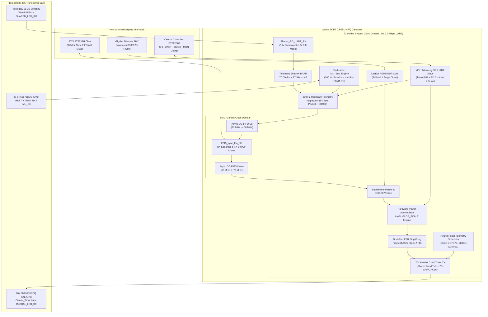

# Central Controller FPGA Gateware Architecture

**Component**: `Colorlight i9` v7.2 Module (`Lattice ECP5 LFE5U-45F-6BG381C`, 44k LUTs, $243\text{ kB}$ EBR Block RAM, $8\text{ MB}$ SDRAM, $16\text{ MB}$ SPI Flash)  
**Toolchain**: Open-source `Yosys` + `nextpnr-ecp5` + `Project Trellis` + `openFPGALoader` (SystemVerilog / Verilog-2005)  
**Primary Role**: High-speed real-time video router, hardware Automatic Brightness Limiter (ABL), 70-channel parallel RS-485 `Chain-Train` transmitter, round-robin node telemetry collector, and 200 Hz synchronized IMU bus controller.

---

## 1. Role of the FPGA in the System

A microcontroller cannot simultaneously bit-bang or DMA 70 independent $3.0–4.0\text{ Mbps}$ RS-485 UART channels while parsing $13–20\text{ MB/s}$ of incoming USB video and polling a 71st high-speed IMU RS-485 bus. The `Lattice ECP5-45F` FPGA solves this cleanly in parallel hardware:

1. **High-Speed Frame Ingestion**: Drains pre-shuffled display frames from the Phone over the **`FTDI FT2232H` 60 MHz Synchronous FIFO** ($40\text{ MB/s}$), or over **Gigabit Ethernet (`ETH0`)** via an integrated `LiteEth` UDP/sACN MAC core.
2. **Real-Time Power Accumulation & Hardware ABL (`GLOB_SCALE`)**: Sums the total RGB current demand of each incoming frame on-the-fly and scales the outgoing `GLOB_SCALE` ($0..255$) header byte so total jacket power never exceeds the active USB-PD 3.1 EPR contract ($65\text{W}–240\text{W}$) or external $+5\text{V}$ supply ceiling ($800\text{W}+$).
3. **70-Channel Parallel RS-485 `Chain-Train` Transmission**: Simultaneously drives 70 independent UART transmit lines (`CHAIN_TX[0..69]`) at $3.000\text{ Mbps}$ (or $4.000\text{ Mbps}$) with zero inter-chain skew, appending per-chain `CRC-16/CCITT` checksums and triggering a global simultaneous frame latch across all 112,200 LEDs via the RS-485 `EOF_IDLE` break.
4. **70-to-1 Wired-AND Telemetry Reception**: During the $150\,\mu\text{s}$ inter-frame blanking interval, flips the shared `GLOBAL_LED_DE` line to Receive mode and captures the 10-byte temperature/voltage telemetry reply from the single polled `(chain, slot)` node over the `SHARED_LED_RO` Schottky-diode Wired-AND bus.
5. **Dedicated 71st RS-485 Bus (`IMU_BUS`) Master**: Independently triggers a 200 Hz synchronized sample-and-hold broadcast (`CMD_IMU_POLL`) to the 4 sleeve `IMUNode`s and receives their 4 TDMA quaternion packets on a dedicated transceiver (`U71`).
6. **Housekeeping MCU Bridge & Upstream USB Telemetry Formatter**: Exchanges power contract and Torso IMU packets with the onboard Central Controller `PY32F003F18U6` (`U_MCU1`), merges them with sleeve IMUs and node temperatures, and streams 64-byte telemetry packets back to the Phone at 200 Hz.

---

## 2. Internal Gateware Architecture & Block Diagram

---

## 3. Detailed Subsystem Descriptions

### 3.1 Clock Architecture
The ECP5 runs two primary clock domains bridged by Lattice `DCFIFO` (dual-clock asynchronous Block RAM FIFOs with Gray-coded pointers):
1. **`clk_ftdi` ($60.0\text{ MHz}$)**: Sourced directly from the `FT2232H` `CLKOUT` pin. Drives the synchronous `FT245` state machine (`OE#`, `RD#`, `WR#`, `SIWU#`) with zero clock-domain crossing latency at the I/O pads.
2. **`clk_sys` ($72.0\text{ MHz}$)**: Generated by an internal ECP5 `EHXPLLL` from the `Colorlight i9` onboard $25.0\text{ MHz}$ crystal oscillator.
   - **Why $72.0\text{ MHz}$?**: $72.0\text{ MHz}$ is an exact integer multiple of both **$3.000\text{ Mbps}$** ($\div 24$) and **$4.000\text{ Mbps}$** ($\div 18$), enabling zero-jitter UART bit-timing and $16\times$/$24\times$ receiver oversampling, while easily sweeping across all 70 chains ($70\text{ cycles} < 180\text{ cycles per byte}$).

### 3.2 Frame Ingestion & Cut-Through vs. Ping-Pong Buffering
- **`FT245_Sync_FIFO_Controller`**:
  - Prioritizes Upstream Telemetry TX whenever a 64-byte packet is ready in `ASYNC_FIFO_UP` and `TXE# == 0` (asserting `SIWU#` on byte 64).
  - Otherwise, whenever `RXF# == 0` and `ASYNC_FIFO_DOWN` is not full, asserts `OE#` and `RD#` to stream incoming video bytes at $60\text{ MB/s}$ peak ($40\text{ MB/s}$ sustained).
- **Buffering Modes**:
  - **Double-Buffered Store-and-Forward Mode (Default for Full-Frame ABL)**: Incoming bytes are written into **Frame Buffer Bank A** (in ECP5 EBR Block RAM or onboard $8\text{ MB}$ `W9864G6KH` SDRAM for full 112k-LED uncompressed frames) while the `Hardware Power Accumulator` sums the exact total current of the frame. Upon verifying `PAYLOAD_CRC32`, the FPGA computes the exact `GLOB_SCALE` factor for that frame, swaps Bank A $\leftrightarrow$ Bank B, and triggers the 70-channel `ChainTrain_TX` broadcast.
  - **Low-Latency Cut-Through Mode**: Uses the previous frame's EMA-smoothed current + hardware fast-clamp to set `GLOB_SCALE` immediately, streaming 70-way byte-interleaved data directly from a $14\text{ kB}$ circular EBR FIFO to the 70 UART transmitters with **$< 50\,\mu\text{s}$ FPGA transit latency**.

### 3.3 The 70-Channel Parallel `ChainTrain_TX` Engine
Because all 70 LED RS-485 chains transmit in lockstep (`GLOBAL_LED_DE = 1`), the FPGA does **not** need 70 bloated independent UART peripherals. Instead, it uses a **Single Shared Timebase + 70 Lightweight Datapath Slices**:
- **Shared Control Unit**:
  - 1× Baud-Rate Divider ($\div 24$ for $3.0\text{ Mbps}$, or $\div 18$ for $4.0\text{ Mbps}$).
  - 1× Bit-Phase Counter ($0..9$: Start bit `'0'`, Data bits `b0..b7` LSB-first, Stop bit `'1'`).
  - 1× Byte-Index Counter ($0 .. \text{MAX\_CHAIN\_BYTES} + 5$) and State Machine (`IDLE` $\rightarrow$ `TX_HEADER_4B` $\rightarrow$ `TX_PAYLOAD` $\rightarrow$ `TX_CRC16_2B` $\rightarrow$ `TX_EOF_BREAK` $\rightarrow$ `RX_TURNAROUND_150US`).
- **Per-Chain Slice (`chain_slice[0..69]`, only ~45 LUTs per chain = 3,150 LUTs total for all 70 chains!)**:
  - 1× 10-bit UART Shift Register (`{1'b1, tx_byte[7:0], 1'b0}`).
  - 1× 16-bit `CRC-16/CCITT` (`poly = 0x1021, init = 0xFFFF`) LFSR updated once per byte across the header and payload.
  - 1× Active Length Comparator (`byte_idx < chain_active_bytes[c]`): If Chain $c$ is shorter than the longest chain on the jacket, it outputs its `CRC-16` trailer at the end of its own last node and holds `CHAIN_TX[c] = 1` (Idle Mark) while longer chains finish.
- **Global Simultaneous Latch**:
  - Once the longest chain finishes its `CRC-16` trailer, all 70 `CHAIN_TX[0..69]` lines are held HIGH for $20\text{ bit-times}$ ($6.7\,\mu\text{s}$), causing all 850+ `TriangleNode` MCUs to detect `USART_IDLE` and atomically swap their frame buffers within $\pm 300\text{ ns}$ of each other.

### 3.4 Round-Robin Telemetry Scheduler & 70-to-1 Wired-AND Receiver
How do 70 RS-485 chains report node temperatures back to the FPGA using only **1 shared FPGA RX pin (`SHARED_LED_RO`)** and **1 shared direction pin (`GLOBAL_LED_DE`)**?
1. **Hardware Wired-AND Multiplexer**:
   - All 70 `SN65176BDQ` `RO` outputs are idle-HIGH ($+5.0\text{V}$).
   - Each `RO` pin connects to the cathode of a low-$V_F$ Schottky diode (`RB521S-30`, $V_F \approx 0.25\text{V}$). All 70 anodes join at `SHARED_LED_RO` with a $1\text{k}\Omega$ pull-up to $+3.3\text{V}$.
   - When 69 chains are idle (`RO = 5V`), their diodes are reverse-biased. When the 1 polled node transmits a `'0'` (`RO = 0V`), its diode pulls `SHARED_LED_RO` down to $0.25\text{V}$ (a clean logic `'0'` at the $3.3\text{V}$ FPGA input!).
2. **Round-Robin Header Injection**:
   - On Frame $f$, the FPGA's `RR_Scheduler` selects:
     $$\text{Polled Chain } c^* = f \bmod 70, \qquad \text{Polled Slot } k^* = \left\lfloor \frac{f}{70} \right\rfloor \bmod N_{\text{nodes}}(c^*)$$
   - In the 4-byte `Chain-Train` header (`0x55`, `CMD_FRAME_DATA`, `GLOB_SCALE`, `POLL_CFG`), **only Chain $c^*$** has bit 7 of `POLL_CFG` set (`POLL_CFG = 0x80 | k^*`). All other 69 chains transmit `POLL_CFG = 0x00` (`POLL_EN = 0`).
3. **$150\,\mu\text{s}$ Inter-Frame Turnaround Window**:
   - Immediately after the `EOF_IDLE` latch period, the FPGA drives `GLOBAL_LED_DE = 0` for **$150\,\mu\text{s}$**.
   - At $T_{\text{EOF}} + 15\,\mu\text{s}$, Node $k^*$ on Chain $c^*$ transmits its 10-byte `RSP_TELEMETRY` packet ($33.3\,\mu\text{s}$ duration at $3.0\text{ Mbps}$).
   - The FPGA's `Shared_RO_UART_RX` verifies the `CRC-16` of the 10-byte reply and writes `{temp_half_c, vdd_20mv, flags}` into `Telemetry_BRAM[c^*][k^*]`.
   - At $60\text{ FPS}$, all $70$ chains are polled every $1.17\text{ seconds}$, and every node on the jacket is refreshed every $15–30\text{ seconds}$ (more than $10\times$ faster than thermal time constants). Furthermore, the FPGA can prioritize polling the hottest known nodes more frequently.

---

## 4. How Telemetry & Thermal/Power Throttling Work Together

A core architectural requirement is ensuring the jacket can plug into **any power source**—from a small $65\text{W}$ laptop charger or $140\text{W}$ MacBook brick, up to a $240\text{W}$ USB-PD 3.1 EPR power bank (`48V @ 5A`), or an $800\text{W}+$ external $+5\text{V}$ stage supply—and automatically run as brightly as safely possible without ever tripping the supply's over-current protection (OCP) or overheating the garment.

### 4.1 Who Does the Power & Thermal Throttling? (4-Tier Defense-in-Depth)

Throttling is split across **four coordinated hardware/firmware tiers**, ordered from slowest/predictive to fastest/hardware-enforced:

| Tier | Executing Component | Control Loop Rate | Input Signals | Throttling Action | Purpose |
| :--- | :--- | :---: | :--- | :--- | :--- |
| **Tier 1: Supply Contract Ceiling** | **Central Controller MCU (`PY32F003`)** | $100\text{ Hz}$ (and on PD attach IRQ) | `HUSB239` / `TPS26750` I2C PDO registers + `EXT_5V_SENSE` GPIO | Sends `P_max_watts` & `I_5V_max_amps` to FPGA over SPI/UART. | Adapts dynamically to whether $65\text{W}$, $100\text{W}$, $140\text{W}$, $240\text{W}$ EPR, or $800\text{W}$ external $+5\text{V}$ is plugged in. |
| **Tier 2: Frame-by-Frame Hardware ABL** | **FPGA Gateware (`abl_engine.sv`)** | **$60–120\text{ Hz}$ (Every Video Frame, $0\text{ ms}$ lag)** | Exact sum of incoming frame `(R + G + B)` + quiescent power baseline + Tier 1 `I_5V_max` + max buck/jacket temp | Computes 8-bit **`GLOB_SCALE` ($0..255$)** embedded in Byte 2 of every `Chain-Train` frame header. | Allows sparse effects (sparks, text, outlines) to run at **100% full 24-bit brightness**, while smoothly scaling down full-jacket white flashes so total current never exceeds `I_5V_max`. |
| **Tier 3: Node-Local Autonomous Thermal Derating** | **`TriangleNode` MCU (`PY32F003`)** | $10\text{ Hz}$ per node (autonomous) | On-die `ADC_IN11` temperature sensor referenced against `ADC_IN12` (`VREFINT = 1.20V`) | Multiplies incoming `GLOB_SCALE` by local `thermal_scale` ($100\%$ at $\le 65^\circ\text{C}$, linear ramp to $20\%$ at $85^\circ\text{C}$, $0\%$ cutoff at $90^\circ\text{C}$). | Protects the wearer and PCB even if a single triangle is covered by a backpack strap or if host telemetry is ignored. |
| **Tier 4: Fast Analog Over-Current Clamp** | **Central Controller MCU (`PY32F003`) + FPGA** | **$20\text{ kHz}$ ADC (`50 µs` response)** | Real-time `BUCK_IMON` analog current sense from the 3× `TI LMG708B0` GaN buck stages (`PA0`) | If $I_{\text{buck}} > 0.95 \times I_{\text{max}}$, asserts `FAST_THROTTLE` pin to FPGA (halving `GLOB_SCALE` on next frame) or pulses `GLOBAL_LED_DE` low. | Prevents transient load spikes or corrupt frames from tripping the USB-PD power bank's hardware OCP fuse. |

### 4.2 FPGA Hardware ABL Math (`GLOB_SCALE` Calculation)
Inside the FPGA's `abl_engine.sv` module, as the $N_{\text{LED}}$ pixels of Frame $f$ stream in from the USB FIFO:
1. **Quiescent Power Subtraction**:
   The jacket's electronics and 1010 LED driver ICs draw a baseline quiescent current $I_{\text{idle}}$ (e.g., $\sim 0.35\text{ mA}$ per 1010 LED at $5.0\text{V}$ plus $10\text{ mA}$ per `PY32F003`/`SN65176B` node). The FPGA subtracts $I_{\text{idle}}$ from the available $5\text{V}$ current budget $I_{\text{budget}}$ (which already accounts for the $95\%$ efficiency of the `LMG708B0` GaN buck stage converting $48\text{V} \rightarrow 5.0\text{V}$):
   $$I_{\text{LED,max}} = \left(\frac{0.95 \times P_{\text{PD,contract}}}{V_{\text{bus,5V}}}\right) - I_{\text{idle}}$$
2. **Frame RGB Current Integration**:
   Each LED channel (`R, G, B`) draws $I_{\text{ch,max}} \approx 5.0\text{ mA}$ at digital value `255` (after 2.2 gamma expansion, the FPGA uses a 256-entry 16-bit gamma-squared lookup table `gamma_lut[val]` so the current sum reflects the *actual post-gamma LED current* that the `TriangleNode` will drive!):
   $$S_{\text{frame}} = \sum_{i=1}^{N_{\text{LED}}} \Big(\text{gamma\_lut}[R_i] + \text{gamma\_lut}[G_i] + \text{gamma\_lut}[B_i]\Big)$$
3. **Computing `GLOB_SCALE`**:
   - If $S_{\text{frame}} \le S_{\text{threshold}}(I_{\text{LED,max}})$, then:
     $$\text{GLOB\_SCALE}_{\text{ABL}} = 255 \quad (\text{No throttling needed!})$$
   - If $S_{\text{frame}} > S_{\text{threshold}}(I_{\text{LED,max}})$, the FPGA computes the reciprocal scale using a 1-cycle pipelined hardware divider / LUT:
     $$\text{GLOB\_SCALE}_{\text{ABL}} = \left\lfloor 255 \times \frac{S_{\text{threshold}}(I_{\text{LED,max}})}{S_{\text{frame}}} \right\rfloor$$
   - Finally, the FPGA applies the Phone's user brightness fader (`USER_BRIGHT`) and any Central Controller thermal derating (`CC_THERM_SCALE`):
     $$\text{GLOB\_SCALE}_{\text{out}} = \frac{\text{GLOB\_SCALE}_{\text{ABL}} \times \text{USER\_BRIGHT} \times \text{CC\_THERM\_SCALE}}{255 \times 255}$$

> [!IMPORTANT]
> **Why FPGA Hardware ABL + Node Delta-Sigma Dithering is a Breakthrough Combination**:
> When the jacket displays typical dynamic visual effects ($10\%–20\%$ average pixel density), `GLOB_SCALE` remains at `255` (`100%`) even on a $100\text{W}–240\text{W}$ USB-PD bank! And when a full-white strobe hits (`100%` density) and the FPGA clamps `GLOB_SCALE` down to fit the $240\text{W}$ envelope, the `TriangleNode` MCUs multiply `GLOB_SCALE` into their **16-bit (`Q8.8`) Delta-Sigma ($\Delta\Sigma$) dithering target** at $1,695\text{ Hz}$—preserving smooth color ratios and zero flicker even at $2.5\%$ duty cycle!
