# Sleeve IMU Node Firmware & Dedicated RS-485 Bus Specification

**Component**: `IMUNode` PCB (`4x` boards distributed along the jacket sleeves: `Left Upper Arm`, `Left Forearm/Wrist`, `Right Upper Arm`, `Right Forearm/Wrist`)  
**Hardware Stack**:
- **MCU**: Puya `PY32F003F18U6` (`U1`, 32-bit ARM Cortex-M0+ @ $24.0\text{ MHz}$, $64\text{ kB}$ Flash, $8\text{ kB}$ SRAM, `QFN-20`)
- **6-Axis IMU**: STMicroelectronics `LSM6DSV16X` (`U3`, `LGA-14L` $2.5\times 3.0\text{ mm}$ with hardware `SFLP` Sensor Fusion Low Power DSP)
- **Local LDO**: Microchip `MIC5504-3.3YM5` (`U4`, $+5\text{V} \rightarrow +3.3\text{V}$, $300\text{ mA}$ clean analog/digital supply for MCU and IMU)
- **RS-485 Transceiver**: Texas Instruments `SN65176BDQ` (`U2`, connected to the dedicated 71st RS-485 bus `IMU_BUS_A/B`)

---

## 1. Architectural Separation: Why the IMU Nodes Have Their Own RS-485 Bus

Unlike the `TriangleNode` LED boards, the 4 sleeve `IMUNode`s reside on their own **dedicated 71st RS-485 differential bus (`IMU_BUS_A` / `IMU_BUS_B`, driven by transceiver `U71` on the Central Controller)**:

1. **Zero Contention with High-Current LED Video Frames**:
   - The 70 LED display chains spend $>95\%$ of every $16.67\text{ ms}$ frame streaming multi-kilobyte `Chain-Train` pixel payloads downstream.
   - Because `IMU_BUS` is physically separate with its own dedicated FPGA `IMU_TX`, `IMU_RX`, and `IMU_DE` pins, the FPGA can poll all 4 sleeve IMUs at a deterministic **$200\text{ Hz}$ ($5.0\text{ ms}$) or $400\text{ Hz}$ ($2.5\text{ ms}$) rate** completely asynchronously from the LED frame rate.
2. **Microsecond-Synchronized Full-Body Sample-and-Hold**:
   - For accurate 3D upper-body inverse kinematics (tracking fast arm swings, wrist rotations, and dance beats), all 5 IMUs (1 Torso + 4 Sleeve) must sample their orientation at the **exact same instant in time** so there is zero motion-capture phase skew between the upper arm and wrist.
3. **Why 6-Axis `LSM6DSV16X` SFLP + Kinematic Constraints (No Magnetometer)**:
   - The jacket carries up to $45\text{A}–160\text{A}$ of dynamic $+5\text{V}$ DC LED current through the sleeves and torso. A $2.5\text{A}$ current in a ribbon cable $5\text{ mm}$ away from an IMU generates a $1.0\text{ Gauss}$ ($100\,\mu\text{T}$) magnetic field—twice the strength of Earth's magnetic field ($0.5\text{ Gauss}$)—which would violently corrupt a 9-axis magnetometer heading whenever the LEDs flash!
   - Instead, each `IMUNode` uses the `LSM6DSV16X`'s ultra-low-drift 6-axis hardware **Game Rotation Vector (`SFLP`)** for rock-solid pitch/roll and short-term yaw, while the Phone app corrects long-term relative yaw drift between the Torso and Arms using biomechanical elbow/shoulder joint constraints (a human elbow is a 1-DOF hinge joint!).

---

## 2. `IMUNode` Pinout & Hardware Mapping

```text
                       +------------------------------+
     USART1_RX / PB7   | 1                         20 | PB6 / USART1_TX (To SN65176B DI)
          PF0 / OSC_IN | 2                         19 | PF4 / BOOT0 (10k to GND)
         PF1 / OSC_OUT | 3                         18 | PF2 / NRST (To TC2030 J_SWD)
      IMU_INT2 / PA0   | 4                         17 | PA14 / SWCLK (To TC2030 J_SWD)
      IMU_INT1 / PA1   | 5      PY32F003F18U6      16 | PA13 / SWDIO (To TC2030 J_SWD)
   STATUS_LED / PA2    | 6      (IMUNode U1)       15 | PA12 / NC
                 PA3   | 7                         14 | PA7 / SPI1_MOSI (To LSM6DSV16X SDA/SDI)
                   GND | 8                         13 | PA6 / SPI1_MISO (From LSM6DSV16X SDO/SA0)
       +3.3V (MIC5504) | 9                         12 | PA5 / SPI1_SCK  (To LSM6DSV16X SCL/SPC)
      SPI1_NSS / PA4   | 10                        11 | PB5 / RS485_DE  (To SN65176B DE & /RE)
                       +------------------------------+
```

- **3.3V Logic Domain (`MIC5504-3.3YM5`)**: Because the `LSM6DSV16X` has a maximum $V_{DD}$ rating of $3.6\text{V}$, the `IMUNode` runs both the `PY32F003F18U6` and the `LSM6DSV16X` at $+3.3\text{V}$ from `U4` (`MIC5504-3.3YM5`), while the `SN65176BDQ` (`U2`) runs from $+5.0\text{V}$ (`RO` divided down to $3.3\text{V}$ via a $2.2\text{k}\Omega / 3.3\text{k}\Omega$ divider; `DI` and `DE` have TTL-compatible $V_{IH} = 2.0\text{V}$, driven directly by $3.3\text{V}$ `PB6`/`PB5`).

---

## 3. `IMUNode` Firmware Architecture

```mermaid
flowchart LR
    subgraph IMU_IC ["LSM6DSV16X Silicon (U3)"]
        GYRO_ACC["3D Gyro + 3D Accel<br/>@ 480 Hz ODR (Low-Noise Mode)"]
        SFLP_DSP["Embedded SFLP DSP<br/>6-Axis Game Rotation Vector<br/>+ Gravity + Linear Accel"]
        FIFO["Hardware FIFO / Output Regs<br/>Quat (Float16) + LinAccel (int16)"]
        GYRO_ACC --> SFLP_DSP --> FIFO
    end

    subgraph MCU_FW ["PY32F003F18U6 Firmware (U1)"]
        SPI_DRV["SPI1 Mode 3 DMA Driver<br/>(8 MHz Burst Read on INT1)"]
        F16_Q14["Fast Float16 -> Q14 Converter<br/>& Latest Sample Ring Buffer"]
        SYNC_LATCH["USART1 Broadcast Latch<br/>Freeze Sample on CMD_IMU_POLL (0x50)"]
        TDMA_TIMER["TIM14 Deterministic Slot Timer<br/>Delay = 20 us + slot_id * 80 us"]
        TX_DMA["USART1_TX DMA (3.0 Mbps)<br/>18-Byte RSP_IMU_DATA (0x51)"]
    end

    FIFO -- "INT1 (PA1)" --> SPI_DRV
    SPI_DRV --> F16_Q14
    F16_Q14 --> SYNC_LATCH
    SYNC_LATCH --> TDMA_TIMER --> TX_DMA
```



### 3.1 `LSM6DSV16X` Configuration (`lsm6dsv16x_init()`)
At boot, the `PY32F003` configures the `LSM6DSV16X` over `SPI1` (`8.0 MHz`, Mode 3 `CPOL=1, CPHA=1`):
1. **Verify Silicon ID**: Reads `WHO_AM_I (0x0F)` and verifies `0x70`.
2. **High-Accuracy ODR & Full-Scale Ranges**:
   - Accelerometer (`CTRL1 = 0x10`): `ODR = 480 Hz` High-Performance mode, Full-Scale = `±8 g` (prevents clipping during fast dance punches/jumps).
   - Gyroscope (`CTRL2 = 0x11`): `ODR = 480 Hz` High-Performance mode, Full-Scale = `±2000 dps` (prevents saturation during rapid wrist flicks, which would otherwise introduce heading offset).
3. **Enable Embedded `SFLP` Game Rotation Vector**:
   - Enables Embedded Functions bank (`FUNC_CFG_ACCESS = 0x80`).
   - Enables `SFLP_GAME_EN = 1` in `EMB_FUNC_EN_A (0x04)` and configures `SFLP_ODR = 480 Hz` in `SFLP_ODR (0x5E)`.
   - Enables automatic gyroscope bias learning (`SFLP_GYRO_BIAS_INIT`) so stationary arm rests automatically zero out temperature-induced gyro drift.
4. **Data-Ready Interrupt**:
   - Routes `SFLP` data-ready / FIFO threshold to `INT1` (`PA1`). Every $2.08\text{ ms}$ ($480\text{ Hz}$), the `PY32F003` reads the latest quaternion (`SFLP_QUATW..Z` in IEEE 754 `Float16`), converts it in $< 4\,\mu\text{s}$ to normalized signed 16-bit fixed-point (`Q14`, where $\pm 1.0 = \pm 16384$), and reads the 3-axis linear acceleration `(ax, ay, az)`, storing them in an atomic double-buffered struct `latest_imu_state`.

---

## 4. Dedicated `IMU_BUS` RS-485 Wire Protocol

The `IMU_BUS` operates at **$3.000\text{ Mbps}$ (`8N1`)** using a **Broadcast Sample-and-Hold Trigger + Deterministic 4-Slot TDMA Response** architecture.

### 4.1 Timing Diagram of One $200\text{ Hz}$ ($5.0\text{ ms}$) Poll Cycle

```text
Time (us):  0        20   26    46           106  126          186  206          266  286          346        5000 us
            |----20---|6us|--20--|-----60-----|-20-|-----60-----|-20-|-----60-----|-20-|-----60-----|          |
IMU_BUS:    [CMD_POLL][IDL]      [RSP Slot 0 ]     [RSP Slot 1 ]     [RSP Slot 2 ]     [RSP Slot 3 ]  (Idle)  [Next]
Driver:     |--FPGA--|           |--IMUNode 0|     |--IMUNode 1|     |--IMUNode 2|     |--IMUNode 3|
                                 (L Upper Arm)     (L Wrist)         (R Upper Arm)     (R Wrist)
```

- **Total Active Bus Time per Poll**: $26\,\mu\text{s} + 4 \times 80\,\mu\text{s} = \mathbf{346\,\mu\text{s}}$.
- **Bus Utilization at $200\text{ Hz}$**: $346\,\mu\text{s} / 5,000\,\mu\text{s} = \mathbf{6.9\%}$ (even at $400\text{ Hz}$, utilization is only $13.8\%$!).

### 4.2 Downstream Broadcast Poll Frame: `CMD_IMU_POLL (0x50)` (FPGA $\rightarrow$ All 4 `IMUNode`s)
Every $5.0\text{ ms}$, the FPGA asserts `IMU_DE = 1` and transmits a **6-byte broadcast frame**:

| Byte | Field | Value | Description |
| :---: | :--- | :---: | :--- |
| `0` | `SYNC` | `0x55` | `01010101b` alternating bit pattern for `TIM1` HSI auto-baud trim on all 4 `IMUNode`s. |
| `1` | `OPCODE` | `0x50` | `CMD_IMU_POLL` — Synchronized Sample-and-Hold + TDMA Readout Trigger. |
| `2` | `TARGET_MASK`| `0x0F` | Bitmask of TDMA slots requested (`Bit 0..3` = Slots `0..3`; `0x0F` = all 4 sleeve IMUs). |
| `3` | `SEQ_NUM` | `0..255`| Poll sequence number (echoed by all 4 `IMUNode`s to guarantee sample alignment). |
| `4..5`| `CRC16` | `uint16_le`| `CRC-16/CCITT` (`poly = 0x1021, init = 0xFFFF`) over Bytes `0..3`. |

**Simultaneous Sample-and-Hold Action**:
Upon detecting the `USART_IDLE` interrupt at the end of `CMD_IMU_POLL` ($T = 26\,\mu\text{s}$), **all 4 `IMUNode`s simultaneously copy `latest_imu_state` into `tx_latched_sample`** and start their hardware `TIM14` microsecond TDMA slot timer:
$$t_{\text{TX\_start}}(m) = 20\,\mu\text{s} + m \times 80\,\mu\text{s}, \qquad m \in \{0, 1, 2, 3\}$$

### 4.3 Upstream TDMA Response Frame: `RSP_IMU_DATA (0x51)` (`IMUNode m` $\rightarrow$ FPGA)
When `TIM14` expires for `IMUNode` $m$, the node asserts `RS485_DE = 1` (`PB5`), waits $1\text{ bit-time}$ ($333\text{ ns}$), and transmits its **18-byte `RSP_IMU_DATA` packet** via `USART1_TX` DMA ($60.0\,\mu\text{s}$ wire time at $3.0\text{ Mbps}$):

```text
+---------------------------------------------------------------------------------------------------+
|                        SLEEVE IMU NODE -> FPGA TDMA RESPONSE (18 Bytes)                           |
+-------------+---------------+---------------------------------------------------------------------+
| Byte Offset | Field Name    | Description                                                         |
+-------------+---------------+---------------------------------------------------------------------+
| 0           | SYNC          | 0x55 (Preamble / Sync)                                              |
| 1           | OPCODE        | 0x51 (RSP_IMU_DATA)                                                 |
| 2           | SLOT_AND_SEQ  | Bits [7:6] = limb_slot_id (0..3); Bits [5:0] = SEQ_NUM[5:0]         |
| 3           | STATUS_TEMP   | Bit 7 = GYRO_CAL_OK; Bits [6:0] = IMU Temperature in deg C (0..127) |
| 4..5        | QUAT_W        | int16_le: Game Rotation Vector Quaternion W (Q14: -16384..+16384)   |
| 6..7        | QUAT_X        | int16_le: Game Rotation Vector Quaternion X (Q14: -16384..+16384)   |
| 8..9        | QUAT_Y        | int16_le: Game Rotation Vector Quaternion Y (Q14: -16384..+16384)   |
| 10..11      | QUAT_Z        | int16_le: Game Rotation Vector Quaternion Z (Q14: -16384..+16384)   |
| 12..13      | LIN_ACC_X     | int16_le: Linear Acceleration X in mg (gravity removed)             |
| 14..15      | LIN_ACC_Y     | int16_le: Linear Acceleration Y in mg (gravity removed)             |
| 16..17      | CRC16         | uint16_le: CRC-16/CCITT (poly 0x1021) over Bytes 0..15              |
+---------------------------------------------------------------------------------------------------+
```
Immediately upon the `USART_TC` (Transmission Complete) interrupt of Byte 17, the node drives `RS485_DE = 0`, leaving a generous **$20\,\mu\text{s}$ ($60\text{ bit-time}$) tri-state guard band** before `IMUNode` $m+1$ asserts its transmitter.

---

## 5. Zero-Flash Commissioning & Gesture-Based Limb Assignment

All 4 `IMUNode` PCBs are flashed at the factory with the **exact same firmware binary**—no per-limb hardcoded IDs are needed:
1. **Electronic UID Discovery on `IMU_BUS`**:
   - During jacket commissioning, the FPGA runs the standard `CMD_DISC_SLOTS (0x10)` Slotted-Aloha discovery command on `IMU_BUS` (with $S = 16$ time slots). With only 4 nodes on the bus, all 4 `IMUNode` 96-bit factory `UID`s are discovered in **$< 5\text{ ms}$** and assigned temporary TDMA slots $0..3$.
2. **5-Second Interactive Motion Gesture Mapping**:
   - How does the Phone know which `UID` is on the *Left Upper Arm*, *Left Wrist*, *Right Upper Arm*, or *Right Wrist*?
   - Either:
     - **Automatic `+5V` IR-Drop Sorting**: On each sleeve, the Wrist IMU is further down the sleeve power harness than the Upper Arm IMU, so its local $+5\text{V}$ rail sags slightly more when the sleeve LEDs pulse.
     - **1-Step Interactive Gesture Calibration in the Phone App**: The companion app displays a 3-second prompt: *"Wave your LEFT hand, then your RIGHT hand."*
       - During the Left Hand wave, the 2 Left Sleeve IMUs exhibit high angular velocity ($\|\boldsymbol{\omega}\| > 150^\circ/\text{s}$), and the **Left Wrist IMU** exhibits $2\times–3\times$ higher linear acceleration ($\|\mathbf{a}_{\text{lin}}\|$) than the **Left Upper Arm IMU** due to its longer lever arm from the shoulder!
       - The Phone immediately binds the 4 `UID`s to `SLOT 0 (L_UPPER)`, `SLOT 1 (L_WRIST)`, `SLOT 2 (R_UPPER)`, and `SLOT 3 (R_WRIST)` and saves them via `CMD_ASSIGN_SLOT (0x12)` into each `IMUNode`'s Flash option page (`0x0800FC00`).
