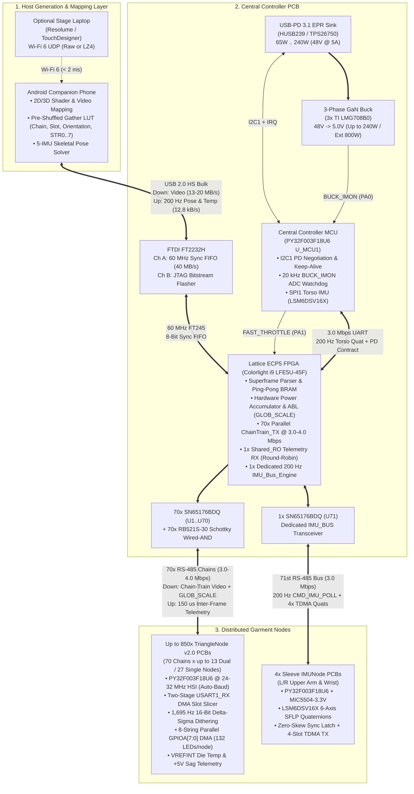

# Project LEDJacket — System Firmware & Gateware Architecture

This repository (`LEDJacket_FW/`) contains the firmware, gateware, and communication protocol specifications for **Project LEDJacket**: a high-density, full-body wearable LED display and motion-capture garment comprising up to **112,200 addressable 1010 RGB LEDs** (`850` Dual-Triangle Nodes / `1,700` triangles across `70` RS-485 daisy chains) and a **5-node 200 Hz IMU skeletal motion-tracking network**.

---

## 1. Component Architecture Specifications (Deep-Dive Documents)

The system architecture is partitioned across five primary hardware/software domains. Click any document below for the complete engineering specification of that subsystem:

| # | Subsystem / Component | Hardware Target | Detailed Specification Document | Key Topics Covered |
| :-: | :--- | :--- | :--- | :--- |
| **1** | **The Phone (Host Companion App & USB Protocol)** | Android Smartphone (`Snapdragon` / `Tensor`) over USB 2.0 HS (`480 Mbps`) | [**`PHONE_AND_USB_PROTOCOL.md`**](./PHONE_AND_USB_PROTOCOL.md) | • Why LED string/orientation reshuffling happens on the Phone (`O(N)` gather LUT)<br>• USB Superframe byte packing (`70-way` chain-interleaved cut-through streaming)<br>• Compression trade-off analysis (`FT2232H` `40 MB/s` USB vs. `RGB565` vs. Wi-Fi 6 `LZ4`)<br>• `200 Hz` 64-byte Upstream USB Telemetry packet format |
| **2** | **Central Controller FPGA Gateware** | `Colorlight i9` v7.2 (`Lattice ECP5 LFE5U-45F`, `44k LUTs`) + `FTDI FT2232H` | [**`FPGA_ARCHITECTURE.md`**](./FPGA_ARCHITECTURE.md) | • Dual-clock gateware (`60 MHz` FT245 Sync FIFO $\leftrightarrow$ `72 MHz` System/UART domain)<br>• 70-channel parallel `ChainTrain_TX` engine (`3.0–4.0 Mbps`)<br>• 70-to-1 Schottky Diode Wired-AND telemetry receiver (`SHARED_LED_RO`)<br>• **4-Tier Power & Thermal Throttling** (`65W–240W` USB-PD 3.1 EPR & `800W+` Ext 5V)<br>• Hardware Automatic Brightness Limiter (ABL) & `GLOB_SCALE` math |
| **3** | **Central Controller Housekeeping & Torso IMU MCU** | Puya `PY32F003F18U6` (`U_MCU1` on Central Controller) | [**`CENTRAL_CONTROLLER_MCU.md`**](./CENTRAL_CONTROLLER_MCU.md) | • Why `PY32F003F18U6` unified the BOM (replacing `ESP32-C5`)<br>• `< 2 ms` cold-boot USB-PD 3.1 EPR (`48V @ 5A = 240W`) negotiation (`HUSB239`/`TPS26750`)<br>• `20 kHz` ADC monitoring of `3x TI LMG708B0` GaN buck current (`BUCK_IMON`) & fast clamp<br>• `200–400 Hz` Torso Reference IMU (`LSM6DSV16X`) SPI polling & FPGA UART bridge |
| **4** | **Sleeve IMU Nodes & Dedicated IMU Bus** | `4x IMUNode` PCBs (`PY32F003F18U6` + `LSM6DSV16X` + `MIC5504-3.3YM5`) | [**`IMU_NODE_FIRMWARE.md`**](./IMU_NODE_FIRMWARE.md) | • Dedicated 71st RS-485 bus (`IMU_BUS_A/B` on `U71`) separate from display chains<br>• Embedded `SFLP` 6-axis Game Rotation Vector quaternion fusion (`480 Hz` internal DSP)<br>• Zero-skew broadcast sample-and-hold (`CMD_IMU_POLL`) + 4-slot TDMA readout (`346 µs` total)<br>• Zero-flash Aloha discovery & 3-second interactive gesture limb assignment |
| **5** | **Triangle Display Nodes (`TriangleNode` v2.0)** | Up to `850x TriangleNode` PCBs (`PY32F003F18U6` + `132x` 1010 RGB LEDs) | [**`TRIANGLE_NODE_FIRMWARE.md`**](./TRIANGLE_NODE_FIRMWARE.md) | • 8-string parallel WS2812 DMA on `GPIOA[7:0]` (`590 µs` subframe = `1,695 Hz` refresh)<br>• Why macro blanking fails & how `1,695 Hz` **16-bit Delta-Sigma ($\Delta\Sigma$) dimming** achieves 12–14 bit smooth gradients at $2.5\%$ power<br>• Two-level Double Buffering (RS-485 frame swap + DMA bit-slice ping-pong)<br>• Slotted-Aloha 96-bit `UID` discovery, `+5V` IR-Drop pre-sort, & Visual Chase ordering<br>• Factory `TC2030` pogo flashing, bench self-test, and `CMD_TEST_MODE` QC plan |
| **6** | **Complete RS-485 Wire Protocol Reference** | All `SN65176BDQ` Buses (`70x LED Chains` + `1x IMU Bus`) | [**`RS485_PROTOCOL_PLAN.md`**](./RS485_PROTOCOL_PLAN.md) | • Complete opcode table, packet byte layouts, `CRC-16/CCITT` framing, `USART_IDLE` line detection, and commissioning state machines |

---

## 2. End-to-End System Architecture Diagram



---

## 3. Architectural Summary Across Key Engineering Questions

### 3.1 Phone Frame Formatting, Reshuffling, & Compression ([`PHONE_AND_USB_PROTOCOL.md`](./PHONE_AND_USB_PROTOCOL.md))
- **Where Does Reshuffling Happen?**: **On the Phone** via a single flat pre-computed gather LUT (`wire_to_canvas_lut[]`) built when loading `jacket_topology.json`. This bakes chain ID, slot order, triangle orientation ($\triangle/\bigtriangledown$), and intra-node 8-string (`STR0..STR7`) `GRB` step order into the phone's existing pixel gather pass at **zero additional runtime cost**, freeing the FPGA from permutation tables and allowing the `TriangleNode` MCU to stream bytes linearly into its bit-transposer.
- **USB Packing**: Encapsulated in CRC-32 protected **USB Superframes** with **70-way byte-interleaved payloads** (`Byte k of Chain 0..69`), allowing the FPGA to stream directly into all 70 UART transmitters with sub-100 µs cut-through latency.
- **Is Compression Needed?**: Over USB, the `FTDI FT2232H` Synchronous FIFO sustains **$40\text{ MB/s}$ ($320\text{ Mbps}$)**, which is faster than all 70 RS-485 buses combined ($168–224\text{ Mbps}$). Complex entropy compression (LZ4/Zstd/H.264) on the FPGA is unnecessary and avoided. Instead, fixed-stride **`FMT_RGB565` ($2\text{ B/LED}$)** and **`FMT_RGB888` ($3\text{ B/LED}$)** are supported natively, cutting RS-485 wire time by $33\%$ in `RGB565` mode while expanding via LUT on the node MCU into the 16-bit Delta-Sigma engine. If streaming wirelessly from a stage laptop to the phone over Wi-Fi 6, lossless **`LZ4`** is decompressed on the Phone CPU ($>3.5\text{ GB/s}$, $<0.1\text{ ms}$) before sending uncompressed frames over USB.

### 3.2 FPGA Gateware & 4-Tier Power/Thermal Throttling ([`FPGA_ARCHITECTURE.md`](./FPGA_ARCHITECTURE.md))
- **Parallel Distribution**: A single shared baud timebase + byte counter drives **70 lightweight UART shift/CRC slices** (~3,150 LUTs total for all 70 chains) out `CHAIN_TX[0..69]` while a 70-to-1 Schottky diode Wired-AND bus (`SHARED_LED_RO`) captures 1 round-robin node's temperature/voltage telemetry during the $150\,\mu\text{s}$ inter-frame blanking window.
- **Who Performs Power & Thermal Throttling?**:
  1. **Tier 1 (Supply Contract Ceiling)**: Central Controller `PY32F003` reads the negotiated USB-PD 3.1 EPR contract ($65\text{W}..240\text{W}$) or external $+5\text{V}$ sense ($800\text{W}+$) and updates the FPGA's `I_5V_max` register.
  2. **Tier 2 (Frame-by-Frame Hardware ABL in FPGA)**: The FPGA sums the post-gamma current of every incoming video frame, subtracts LED/MCU quiescent current, and computes the 8-bit **`GLOB_SCALE` ($0..255$)** header byte on-the-fly so sparse animations run at **100% brightness** while full-white strobes are smoothly scaled to never exceed the power supply.
  3. **Tier 3 (Autonomous Node Thermal Derating)**: Each `TriangleNode` independently measures its die temperature (`ADC_IN11` vs. `VREFINT`) and linearly derates brightness above $65^\circ\text{C}$ ($0\%$ cutoff at $90^\circ\text{C}$).
  4. **Tier 4 ($50\,\mu\text{s}$ Hardware Over-Current Clamp)**: Central Controller `PY32F003` monitors `BUCK_IMON` at $20\text{ kHz}$ and asserts `FAST_THROTTLE` to the FPGA if real-time current approaches $95\%$ of the PD brick's OCP limit.

### 3.3 Central Controller MCU & Torso IMU ([`CENTRAL_CONTROLLER_MCU.md`](./CENTRAL_CONTROLLER_MCU.md))
- The onboard `PY32F003F18U6` (`U_MCU1`) boots in $<1.5\text{ ms}$ to negotiate USB-PD 3.1 EPR (`48V @ 5A`) over `I2C1`, monitors the `3x TI LMG708B0` GaN buck current on `PA0`, polls the onboard Torso Reference `LSM6DSV16X` IMU over `SPI1` at $200–400\text{ Hz}$, and transmits a 24-byte `RSP_CC_STATUS` frame to the FPGA every $5.0\text{ ms}$.

### 3.4 Sleeve IMU Nodes & Dedicated RS-485 Protocol ([`IMU_NODE_FIRMWARE.md`](./IMU_NODE_FIRMWARE.md))
- Reside on a dedicated 71st RS-485 bus (`IMU_BUS_A/B`). Every $5.0\text{ ms}$ ($200\text{ Hz}$), the FPGA broadcasts `CMD_IMU_POLL (0x50)`, triggering all 4 `IMUNode`s to simultaneously latch their `LSM6DSV16X` `SFLP` 6-axis Game Rotation Vector quaternions and reply in deterministic $80\,\mu\text{s}$ TDMA slots (`346 µs` total wire time for all 4 IMUs).

### 3.5 Triangle Nodes: DMA, Delta-Sigma Dimming, Aloha, & Factory Testing ([`TRIANGLE_NODE_FIRMWARE.md`](./TRIANGLE_NODE_FIRMWARE.md))
- **8-String Parallel DMA**: `DMA_Channel1` streams 3-phase bit-sliced waveforms (`0xFF`, `data_bits[7:0]`, `0x00`) at $2.40\text{ MHz}$ to `GPIOA->ODR` (`PA0..PA7`), refreshing all 132 LEDs (17 LEDs max per string) in **$590\,\mu\text{s}$ ($1,695\text{ Hz}$)**.
- **16-Bit Delta-Sigma ($\Delta\Sigma$) Temporal Dimming**: Accumulates 8-bit fractional error remainders at $1,695\text{ Hz}$ so the 8-bit value latched into each 1010 LED oscillates by at most $\pm 1\text{ LSB}$ ($N \leftrightarrow N+1$), avoiding beat-frequency aliasing against the LED's asynchronous $1.2\text{ kHz}$ internal oscillator and delivering 12–14 bit perceptual dimming.
- **Aloha Discovery, Visual Ordering, & Factory Testing**: Discovers 96-bit `UID`s via Slotted-Aloha ($<2.5\text{ s}$ whole jacket), pre-sorts each chain electrically via $+5\text{V}$ IR-Drop sag, confirms order via a 3-second Visual Chase sweep, auto-heals single-node replacements via pigeonhole matching, and validates every factory board via `Tag-Connect TC2030` SWD flashing + `CMD_TEST_MODE (0x20)` (`0.5s Red -> 0.5s Blue -> 0.5s Green -> 3.0s White Fade -> Load Sag & Temp Telemetry`).

---

## 4. Repository Directory Layout

```text
LEDJacket_FW/
├── README.md                        # Master firmware & gateware architecture overview (this file)
├── PHONE_AND_USB_PROTOCOL.md        # Phone frame packing, pre-shuffling LUT, compression & USB protocol
├── FPGA_ARCHITECTURE.md             # Lattice ECP5 gateware, 70x UART TX, hardware ABL & thermal throttling
├── CENTRAL_CONTROLLER_MCU.md        # Central Controller PY32F003 USB-PD 3.1 EPR, Buck IMON & Torso IMU
├── IMU_NODE_FIRMWARE.md             # Sleeve IMUNode firmware, LSM6DSV16X SFLP & 200 Hz TDMA RS-485 bus
├── TRIANGLE_NODE_FIRMWARE.md        # TriangleNode v2.0 8-string DMA, 1,695 Hz Delta-Sigma, Aloha & QC plan
├── RS485_PROTOCOL_PLAN.md           # Wire-level RS-485 packet reference & command opcodes
├── TriangleNodeFirmware/            # PY32F003F18U6 C/C++ firmware project (TriangleNode v2.0)
├── IMUNodeFirmware/                 # (Planned) PY32F003F18U6 C/C++ firmware project (IMUNode)
├── CentralControllerMCU/            # (Planned) PY32F003F18U6 C/C++ firmware project (CentralController U_MCU1)
└── CentralControllerFPGA/           # (Planned) Lattice ECP5 SystemVerilog gateware (Yosys / nextpnr-ecp5)
```
