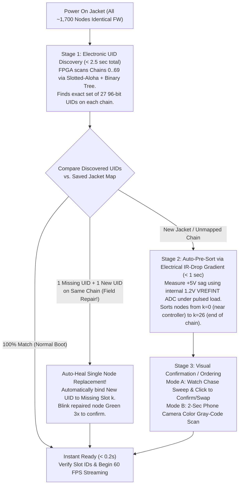

# Project LEDJacket — RS-485 Communication Protocol Plan
**Between Central Controller FPGA (`Lattice ECP5`) & Daisy-Chained Nodes (`TriangleNode` & `IMUNode`)**

---

## 1. Executive Summary & Design Goals

Project LEDJacket distributes real-time video frames from the **Central Controller (`Lattice ECP5` FPGA)** to **~1,700 `TriangleNode` boards** arranged across **~70 independent RS-485 daisy chains** (up to **27 nodes per chain**), while simultaneously collecting die temperature and supply voltage telemetry from the LED nodes and **6-axis game-rotation quaternions** from **4 sleeve `IMUNode` boards** over a dedicated 2-wire RS-485 IMU bus.

This specification defines a **zero-flashing-at-assembly, ultra-low-overhead, deterministic RS-485 protocol** engineered specifically around the hardware capabilities of the **`PY32F003F18U6`** Cortex-M0+ MCU, **`SN65176BDQ`** RS-485 transceiver, and the **`Lattice ECP5`** FPGA transceiver array:

1. **Identical Factory Firmware Across All ~1,700 Nodes**: Every `TriangleNode` is flashed once at the PCB assembly house with the exact same binary. No per-node flashing or manual ID programming is required during jacket assembly or field repairs.
2. **99.86% Payload Efficiency at 60–100+ FPS (`Chain-Train` Slot-Indexed DMA Slicing)**: In normal streaming mode, the FPGA sends **one single contiguous frame train per chain** with a 4-byte chain header and 2-byte trailer (`0.14%` framing overhead). Each node uses hardware `USART_IDLE` line detection and two-stage DMA offset slicing to capture only its own 156-byte (RGB888) or 104-byte (RGB565) slot with $< 0.2\%$ CPU overhead and tear-free global frame latching.
3. **Sub-Second Electronic Discovery + Fast Visual & Electrical Chain Ordering**:
   - **Phase 1 (Electronic UID Discovery, $<2.5\text{ s}$ whole jacket)**: The FPGA discovers the factory 96-bit Unique IDs (`0x1FFF0E00`) of all nodes on each chain using Slotted-Aloha + Binary-Tree prefix collision resolution.
   - **Phase 2 (Physical Chain Ordering, $k = 0\dots 26$)**: Combines **Electrical IR-Drop Gradient Pre-Sorting** (using each node's internal `1.20V` `VREFINT` ADC channel to measure cumulative $+5\text{V}$ rail sag along the daisy chain), **Interactive Visual Chase Verification** (watch a light sweep down the chain and confirm or swap out-of-order nodes in 1 click), and **Camera-Assisted Base-4 Color Gray-Code Mapping** (maps all 1,700 nodes + $\triangle/\bigtriangledown$ orientation in $< 3\text{ seconds}$).
4. **Effortless Single-Node Field Replacement ("Drop-In & Auto-Heal")**: When a single damaged node on a chain is swapped with a fresh factory spare, the Central Controller automatically detects that exactly 1 known UID is missing and 1 new unmapped UID is present on that chain, and immediately binds the new UID into the missing slot $k$ with **zero re-scanning required** (plus a 2-second visual confirmation blink).
5. **Zero-Stall Piggybacked Telemetry & 200 Hz IMU Polling**: Node temperature/voltage queries are embedded directly inside the 4-byte video frame header (`POLL_SLOT`), answered by 1 node per frame during the $150\,\mu\text{s}$ inter-frame blanking interval. Sleeve IMUs run on their own dedicated RS-485 pair (`IMU_BUS_A/B`) polled at 200–400 Hz with zero contention against LED video traffic.

---

## 2. Physical & Data-Link Layer Architecture

### 2.1 Bus Topology & Hardware Mapping

| Bus Parameter | LED Chain Buses (`70× Chains`) | Dedicated Sleeve IMU Bus (`1× Bus`) |
| :--- | :--- | :--- |
| **Transceiver IC** | `SN65176BDQ` (DFN-8, 5V supply, 3.3V-compatible logic inputs) | `SN65176BDQ` (DFN-8, 5V supply) |
| **Nodes per Bus** | Up to **27 `TriangleNode`s** per chain (~70 chains total) | **4 `IMUNode`s** (Left/Right Upper Arm & Wrist) |
| **FPGA TX Topology** | **70 independent `CHAIN_TX[0..69]` pins** (all 70 chains transmit simultaneously in parallel) | **1 dedicated `IMU_TX` pin** |
| **FPGA DE Topology** | **1 shared `GLOBAL_LED_DE` pin** (all 70 LED chains switch TX$\rightarrow$RX together during inter-frame blanking) | **1 dedicated `IMU_DE` pin** |
| **FPGA RX Topology** | **70-to-1 Schottky Diode Wired-AND (`SHARED_RX_3V3`)** into 1 FPGA UART RX pin (only 1 chain & 1 node polled per frame) | **1 dedicated `IMU_RX` pin** |
| **Node MCU Pins** | `PA13` = `USART1_RX` (AF8, via $1\text{k}\Omega$ from `RO`), `PA14` = `USART1_TX` (AF1, to `DI`), `PF4` = `RS485_DE` (to `DE`/`~RE`, $10\text{k}\Omega$ pull-down) | Identical `USART1` + `PF4` mapping on `IMUNode` |
| **Failsafe Idle Bias** | $4.7\text{k}\Omega$ pull-up on `A` to $+5\text{V}$, $4.7\text{k}\Omega$ pull-down on `B` to `GND` on Central Controller ($V_A - V_B > +200\text{ mV} \implies \text{RO} = \text{HIGH}$ when bus undriven) | $4.7\text{k}\Omega$ pull-up on `IMU_A`, $4.7\text{k}\Omega$ pull-down on `IMU_B` |

### 2.2 Baud Rate, Clocking, & Auto-Baud Synchronization
- **MCU Clock Source**: On `TriangleNode`, `PF0` and `PF1` drive the shift registers (`SR_CLK`, `SR_DATA`), so `PY32F003F18U6` runs from its internal **24.0 MHz HSI RC oscillator** (multiplied/trimmed via factory calibration bytes at `0x1FFF0F00`).
- **Line Coding & Baud Rate**:
  - **8N1 NRZ UART** (1 Start bit, 8 Data bits LSB-first, No parity, 1 Stop bit = **10 bits per byte**).
  - **Primary Operating Baud Rate**: **`3.000 Mbps`** (`24.0 MHz / 8` using `USART_CR1.OVER8 = 1`, exact integer division with `0.00%` quantization error!).
  - **Fallback / Long-Harness Baud Rate**: **`2.000 Mbps`** (`24.0 MHz / 12` with `OVER8 = 1`) or **`1.500 Mbps`** (`24.0 MHz / 16` with `OVER8 = 0`), selectable dynamically by the FPGA via a broadcast configuration command.
- **Continuous HSI Clock Drift Compensation (Why 3.0 Mbps Works Reliably Without a Crystal)**:
  - Over a $-10^\circ\text{C}$ to $+85^\circ\text{C}$ LED self-heating swing, an untrimmed RC oscillator can drift by $\pm 1.5\%$ to $\pm 2.5\%$.
  - Every packet from the crystal-locked FPGA begins with a **`SYNC` byte of `0x55`** (`01010101b` — 5 falling edges separated by exact 2-bit intervals).
  - Using `PY32F003`'s built-in **USART Auto-Baud Rate (`ABR`) hardware** (or periodic timer capture across the `0x55` sync header), each node continuously keeps its baud rate locked within **$\pm 0.2\%$** of the FPGA master clock regardless of die temperature!

### 2.3 Frame Delineation via Hardware `IDLE` Line Detection (No Byte-Stuffing Overhead!)
- Rather than wasting bandwidth and CPU cycles on COBS or SLIP byte-stuffing so a "start-of-frame byte" never appears in pixel data, packet boundaries are delineated at the physical layer by **UART Idle-Line Framing**:
  - **Intra-Packet Bytes**: Transmitted back-to-back by the FPGA hardware FIFO with **zero inter-byte gap** ($< 1$ bit-time between stop bit and next start bit).
  - **End-of-Packet Delimiter (`EOF_IDLE`)**: After the final CRC byte of any packet, the FPGA holds the line in UART `MARK` (logic HIGH) for **$\ge 16\text{ bit-times}$** ($\ge 5.33\,\mu\text{s}$ at 3.0 Mbps).
  - **Hardware Detection on `PY32F003`**: After 10 bit-times of continuous HIGH following a stop bit, `USART1->SR.IDLE` hardware flag asserts automatically, generating a single interrupt that marks the exact end of the packet and resets the DMA pointer for the next packet.

---

## 3. Addressing Model & Non-Volatile State

Every `TriangleNode` maintains three identifiers:

1. **Factory 96-Bit Hardware `UID` (`0x1FFF0E00..0x1FFF0E0B`, Read-Only Silicon)**:
   - Programmed by Puya during wafer sort.
   - At boot, firmware also computes a **32-bit `UID_HASH`** using the on-chip AHB `CRC` unit over all 96 bits for compact addressing after discovery, while always retaining the full 12-byte `UID` for zero-collision discovery.
2. **Logical Chain Slot ID (`slot_id` $k \in \{0, 1, \dots, 26\}$, or `0xFF = UNASSIGNED`)**:
   - Represents the node's position ($0 = \text{first node closest to controller}$, $N-1 = \text{last node at end of chain}$) along its current chain.
   - Stored in both **SRAM** and the **final 128-byte Flash page (`0x0800FF80`)** of the `PY32F003` (alongside the bound `chain_id` $c \in \{0..69\}$, a `layout_epoch` counter, and a CRC32 check).
3. **Why Storing the Mapping in BOTH the Central Controller AND the Node's Flash Is Best**:
   - **Central Controller (`ESP32-C5` Flash / FPGA BRAM)** is the **Single Source of Truth**: It stores the master jacket topology table mapping `(chain_id c, slot_id k) <-> 96-bit UID` and orientation $\theta \in \{0^\circ..300^\circ\}$.
   - **Node Flash (`0x0800FF80`)** caches `(chain_id c, slot_id k, layout_epoch)`:
     - On normal power-up, nodes immediately know their `slot_id` at $t = 0\text{ ms}$ (instant boot into animations!).
     - Meanwhile, during the first 1 second after boot, the FPGA verifies all chains in the background using the fast `POLL_UID` check. If the Central Controller detects that a node was moved or replaced, it overrides the node's cached `slot_id` and updates the node's Flash only when changed (protecting Flash endurance!).

---

## 4. High-Bandwidth Display Streaming Protocol ("Chain-Train" Mode)

### 4.1 The "Chain-Train" Packet Structure (0.14% Overhead)

During normal 60–120 FPS video operation, the FPGA transmits **one contiguous frame train** on each of the 70 chains simultaneously:

```
+----------+----------+------------+------------+------------------+------------------+-----+------------------+----------+----------+
| SYNC     | CMD/MODE | POLL_ARG   | GLOB_SCALE | SLOT 0 PAYLOAD   | SLOT 1 PAYLOAD   | ... | SLOT N-1 PAYLOAD | CRC16_L  | CRC16_H  |
| (1 Byte) | (1 Byte) | (1 Byte)   | (1 Byte)   | (156 / 104 / 52B)| (156 / 104 / 52B)|     | (156 / 104 / 52B)| (1 Byte) | (1 Byte) |
+----------+----------+------------+------------+------------------+------------------+-----+------------------+----------+----------+
|<-------------- 4-Byte Header ---------------->|<------------------ N × Payload_Size Bytes ------------------>|<-- 2-Byte Trailer ->|
```

#### Header Fields (4 Bytes Total per Chain):
1. **`SYNC` (`1 Byte = 0x55`)**: Alternating `01010101b` preamble for receiver clock recovery / Auto-Baud verification.
2. **`CMD` (`1 Byte`)**:
   - `Bits [7:4]` = **Packet Type (`0x1` = High-Speed Frame Stream)**:
     - `0x10`: **`STREAM_RGB888`** — $156\text{ bytes/node}$ ($52\text{ LEDs} \times 3\text{ bytes } [R, G, B]$, 24-bit color).
     - `0x11`: **`STREAM_RGB565`** — $104\text{ bytes/node}$ ($52\text{ LEDs} \times 2\text{ bytes}$, 16-bit `RRRRRGGG GGGBBBBB`, expanded to 8-bit gamma-corrected PWM via a 32/64-entry LUT in node SRAM).
     - `0x12`: **`STREAM_LUT8`** — $52\text{ bytes/node}$ ($52\text{ LEDs} \times 1\text{ byte}$ palette index into a 256-color RGB24 table pre-loaded into node SRAM).
     - `0x13`: **`STREAM_RLE_SOLID`** — $3\text{ bytes/node}$ ($1\times [R, G, B]$ solid triangle color per node = only $81\text{ bytes}$ for an entire 27-node chain! Enables **1,000+ FPS** strobe/geometric triangle effects!).
   - `Bits [3:0]` = **Piggybacked Action Flags**:
     - `Bit 0` (`POLL_EN`): If `1`, the node on the **one active polled chain** whose `slot_id == POLL_ARG[4:0]` must transmit a 10-byte Telemetry Reply immediately after the End-of-Frame `IDLE` line!
     - `Bit 1` (`SYNC_LATCH`): If `1` (normal), all nodes latch the newly received frame into their active LED display buffer simultaneously when `USART_IDLE` fires at the end of the train.
3. **`POLL_ARG` (`1 Byte`)**:
   - `Bits [4:0]`: `poll_slot` ($0\dots 26$) — selects which node on this chain is being queried for temperature/voltage telemetry on this frame.
   - `Bits [7:5]`: `telem_type` (`0 = Temp + Vcc + Status`, `1 = Short UID Verify`, `2 = Error Counters`, `7 = No Poll on this Chain`).
   - *Note*: Because all 70 LED chains share `SHARED_RX_3V3` via the Schottky diode Wired-AND bus, for any given video frame, the FPGA sets `POLL_EN = 1` on **exactly ONE of the 70 chains** (e.g., Chain $c = \text{frame\_num} \pmod{70}$), and sets `POLL_EN = 0` on the other 69 chains!
4. **`GLOB_SCALE` (`1 Byte = 0x00..0xFF`)**:
   - Master hardware brightness / power limit scalar ($0 = \text{blackout}$, $66 = \text{240W USB-PD EPR safe cap}$, $255 = \text{800W tethered full power}$).
   - Applied by each node to its `PB6` (`SR_OE_N`) hardware timer PWM duty cycle or row gamma table, multiplied by the node's own local thermal throttling factor!

### 4.2 Zero-CPU Two-Stage DMA Slicing on `PY32F003`

How does Node $k$ extract *only* its own $P$-byte slice (where $P \in \{156, 104, 52, 3\}$) out of the 4,218-byte train without interrupting the CPU on every byte or wasting RAM?

1. **Before Frame Start (Idle State)**:
   - `DMA_Channel_RX` is configured to read `4 bytes` from `USART1->DR` into `rx_header[4]` (`MINC = ENABLED`).
2. **Stage 1 — Header Complete (`t = 13.3 µs` into frame)**:
   - After the 4th byte (`GLOB_SCALE`), `DMA_TC` fires:
   - If `CMD` is a Frame Stream (`0x10..0x13`):
     - If $k == 0$ (First node on chain): DMA immediately points to `pixel_back_buf[P]` with `MINC = ENABLED`, `CNDTR = P`.
     - If $k > 0$: DMA points to a single dummy byte `dummy_discard` with **`MINC = DISABLED` (Memory Increment OFF!)** and `CNDTR = k * P`! The DMA hardware silently consumes and discards the preceding $k \times P$ bytes belonging to upstream nodes $0 \dots k-1$ with **zero CPU intervention and 1 byte of RAM**!
3. **Stage 2 — Prefix Discard Complete (`t = 13.3 µs + k * 520 µs`)**:
   - `DMA_TC` fires at the exact byte boundary where Slot $k$ begins!
   - The 6-instruction ISR enables `MINC = ENABLED`, points `CMAR` to `pixel_back_buf[P]`, sets `CNDTR = P`, and re-enables DMA.
4. **Stage 3 — Slot Capture Complete (`520 µs` later)**:
   - `DMA_TC` fires once all $P$ bytes of Node $k$'s pixel data are in `pixel_back_buf[P]`.
   - For the remainder of the frame train (downstream nodes $k+1 \dots N-1$), DMA is disabled (or discards to `dummy_discard`), leaving `USART_RX` enabled only to watch for the **End-of-Frame `USART_IDLE` interrupt**.
5. **Stage 4 — End-of-Frame `USART_IDLE` Interrupt (Global Tear-Free Frame Swap + Telemetry Reply)**:
   - When the train finishes and the line goes idle for $16\text{ bit-times}$, `USART_IDLE` fires simultaneously on all 27 nodes:
   - Every node swaps its `pixel_front_buf` $\leftrightarrow$ `pixel_back_buf` pointer at the start of its next LED PWM multiplex cycle.
   - If and only if `POLL_EN == 1` and `poll_slot == my_slot_id`, Node $k$ waits $10\,\mu\text{s}$ (for the FPGA to drop `GLOBAL_LED_DE = 0`), asserts its `PF4` (`RS485_DE = 1`), transmits its **10-byte Telemetry Packet** via DMA ($33.3\,\mu\text{s}$ at 3.0 Mbps), drops `PF4 = 0`, and re-arms Stage 1!

### 4.3 Frame Rate & Bandwidth Summary Table (at 3.0 Mbps, 27 Nodes/Chain)

| Streaming Mode | Bytes / Node | Total Chain Bytes (27 Nodes + 6B Framing) | Wire Time per Frame (@ 3.0 Mbps) | Max Sustainable Frame Rate (with 150 µs Telemetry Window) | Protocol Overhead |
| :--- | :---: | :---: | :---: | :---: | :---: |
| **`STREAM_RGB888` (24-bit TrueColor)** | $156\text{ B}$ | $4,218\text{ B}$ | **$14.06\text{ ms}$** | **$70.3\text{ FPS}$** (60 FPS uses 84% bus capacity) | **$0.14\%$** |
| **`STREAM_RGB565` (16-bit High-Speed)** | $104\text{ B}$ | $2,814\text{ B}$ | **$9.38\text{ ms}$** | **$105.0\text{ FPS}$** (60 FPS uses 56% bus capacity) | **$0.21\%$** |
| **`STREAM_LUT8` (8-bit Palette)** | $52\text{ B}$ | $1,410\text{ B}$ | **$4.70\text{ ms}$** | **$206.0\text{ FPS}$** | **$0.42\%$** |
| **`STREAM_RLE_SOLID` (Solid per Node)** | $3\text{ B}$ | $87\text{ B}$ | **$0.29\text{ ms}$** | **$1,000+\text{ FPS}$** | **$6.90\%$** |

---

## 5. Control, Testing, & Discovery Packet Format

Whenever the upper nibble of `CMD` is **not** `0x1` (i.e. `CMD >= 0x20`), the packet is a structured **Control / Discovery / Test Command Packet** (typically $8\text{ to } 32\text{ bytes}$ long):

```
+----------+----------+----------+----------+-----------------------+----------+----------+
| SYNC     | CMD      | TARGET   | LEN      | PAYLOAD               | CRC16_L  | CRC16_H  |
| 0x55     | (1 Byte) | (1 Byte) | (1 Byte) | (0 .. 64 Bytes)       | (1 Byte) | (1 Byte) |
+----------+----------+----------+----------+-----------------------+----------+----------+
```
- **`TARGET` (`1 Byte`)**:
  - `0x00 .. 0x1A` ($0 \dots 26$): Unicast to assigned `slot_id` $k$ on this chain.
  - `0xFE`: **Unicast by 96-bit `UID`** (first 12 bytes of `PAYLOAD` are the target node's 96-bit `UID`; used during commissioning before `slot_id` is assigned!).
  - `0xFF`: **Chain Broadcast** (all nodes on this chain execute the command; no node replies unless the command is a slotted discovery round).
- **`LEN` (`1 Byte`)**: Length of `PAYLOAD` in bytes ($0\dots 64$).
- **`CRC16` (`2 Bytes`)**: `CRC-16/CCITT-FALSE` (`poly = 0x1021, init = 0xFFFF`) over `CMD .. PAYLOAD`. Commands with an invalid CRC16 are strictly ignored.

### Complete Command Table (`CMD` Byte)

| `CMD` Hex | Mnemonic | Direction | Description |
| :---: | :--- | :---: | :--- |
| **`0x10..0x13`** | `STREAM_RGB*` | FPGA $\rightarrow$ Chain | High-speed concatenated video frame train + optional piggybacked slot poll. |
| **`0x20`** | `CMD_TEST_MODE` | FPGA $\rightarrow$ Node/All | Triggers built-in autonomous test pattern (`mode`: RGB sequence, white fade, corner orientation mark, number blink) and/or returns self-test telemetry. |
| **`0x21`** | `CMD_POLL_STATUS` | FPGA $\rightarrow$ Node | Explicit status/temperature/voltage/UID request outside video streaming. |
| **`0x22`** | `RSP_TELEMETRY` | Node $\rightarrow$ FPGA | 10-byte or 22-byte node telemetry & status response. |
| **`0x30`** | `CMD_DISC_RESET` | FPGA $\rightarrow$ Chain | Resets discovery state (`discovery_muted = 0`) on all nodes (or only `UNASSIGNED` nodes) on the chain. |
| **`0x31`** | `CMD_DISC_SLOTS` | FPGA $\rightarrow$ Chain | Initiates a 32-slot or 64-slot Slotted-Aloha UID discovery round with `round_seed`. |
| **`0x32`** | `CMD_DISC_TREE` | FPGA $\rightarrow$ Chain | Deterministic binary prefix-tree query (`bit_len`, `prefix_bits[]`) to resolve any remaining UID collisions with 100% mathematical certainty. |
| **`0x33`** | `CMD_DISC_MUTE` | FPGA $\rightarrow$ UID | Acknowledges a discovered 96-bit `UID`, mutes it from further discovery rounds, assigns a temporary index `temp_idx`, and optionally blinks LED green. |
| **`0x34`** | `RSP_DISC_UID` | Node $\rightarrow$ FPGA | 18-byte Discovery response containing full 96-bit `UID`, current `slot_id`, die temp, and unloaded $V_{CC}$. |
| **`0x40`** | `CMD_SET_SLOT_ID` | FPGA $\rightarrow$ UID | Assigns logical `slot_id` ($0\dots 26$), `chain_id` ($0\dots 69$), and `orientation` ($0\dots 5$) to a specific 96-bit `UID` (optionally committing to Flash `0x0800FF80`). |
| **`0x41`** | `CMD_IR_DROP_PROBE` | FPGA $\rightarrow$ Chain | Runs the automated Electrical IR-Drop Gradient measurement across the chain to pre-sort nodes from upstream ($k=0$) to downstream ($k=26$). |
| **`0x42`** | `CMD_VISUAL_BEACON` | FPGA $\rightarrow$ Chain | Displays either a single-node locator beacon, a sequential chase sweep, or a Base-4 optical Gray-code frame across the chain. |
| **`0x50`** | `CMD_IMU_POLL` | FPGA $\rightarrow$ IMU Bus | Queries `IMUNode` $m \in \{0..3\}$ (or broadcasts sync sample trigger) on the dedicated `IMU_BUS`. |
| **`0x51`** | `RSP_IMU_DATA` | IMU $\rightarrow$ FPGA | 16-byte response from `IMUNode` with `LSM6DSV16X` 6-axis Quaternion `(qw, qx, qy, qz)`, linear accel, gyro status, and temperature. |

---

## 6. Provisions for Testing Nodes (`CMD_TEST_MODE = 0x20`)

Per `docs/TRIANGLENODE_FIRMWARE_KICKOFF.md` and `KICKOFF.md`, nodes support both **Autonomous Factory/Bench Self-Test** and **Host-Triggered Diagnostic Modes** via `CMD_TEST_MODE (0x20)`:

### 6.1 Host-Triggered Standard Test Sequence (`test_submode = 0x01`)
When the Central Controller sends `CMD_TEST_MODE (submode = 0x01)` (either broadcast `TARGET = 0xFF` to test a whole chain/jacket at once, or unicast to a single node):
1. **All 52 LEDs Full Red (`#FF0000`)** for **$0.5\text{ seconds}$**.
2. **All 52 LEDs Full Blue (`#0000FF`)** for **$0.5\text{ seconds}$**.
3. **All 52 LEDs Full Green (`#00FF00`)** for **$0.5\text{ seconds}$**.
4. **All 52 LEDs Smooth White Triangle-Wave Fade (`#000000` $\rightarrow$ `#FFFFFF` $\rightarrow$ `#000000`)** over **$3.0\text{ seconds}$** (verifying smooth PWM dimming on `PB6` / `SR_OE_N`, shift register clocking on `PF0/PF1`, and current draw under full load).
5. **Peak Load Sag & Thermal Capture**: At the peak of the 100% white fade ($t = 3.0\text{ s}$ into the test), the node samples its internal die temperature (`ADC_IN11`) and loaded $+5\text{V}$ supply rail (`ADC_IN12` `VREFINT`) so the host can verify both thermal rise and power-connector contact health!
6. **Report Telemetry**: Immediately upon completing the 4.5-second visual sequence (or when polled by `CMD_POLL_STATUS`), the node returns:
   - `die_temp_c_x10` (e.g. $34.5^\circ\text{C}$),
   - `vcc_idle_mv` (e.g. $5,180\text{ mV}$) and `vcc_full_white_mv` (e.g. $4,720\text{ mV}$),
   - `crc_error_count` & `framing_error_count` (verifying RS-485 signal integrity).

### 6.2 Additional Built-In Diagnostic Submodes (`test_submode = 0x02 .. 0x05`)
- **`0x02` — Shift Register & Individual Matrix Pixel Walk**: Lights LEDs `D1` through `D52` one by one over 2.6 seconds ($50\text{ ms/LED}$) to catch any open or shorted 1010 LED pads (`ROW0..2` vs `COL0..17`).
- **`0x03` — Orientation & Corner Apex Indicator**: Lights the **Top Apex Corner LEDs White**, **Bottom-Left Corner Red**, and **Bottom-Right Corner Green** so the user or camera can verify whether the triangle is mounted upright ($\triangle$) or inverted ($\bigtriangledown$).
- **`0x04` — Visual Slot Number Display**: Renders the node's assigned `slot_id` ($0\dots 26$) directly on the 52-LED triangle using a high-contrast 3-row color bar code (tens digit on top half in Cyan, ones digit as lit dots on the bottom base row in Yellow) so you can read any node's slot ID just by looking at the jacket!
- **`0x05` — Unconfigured / Power-On Standalone Self-Test**: If a freshly manufactured node powers up on a bench supply and detects **zero RS-485 bus activity for $2.0\text{ seconds}$**, it briefly runs a dim 10% brightness R-G-B-White self-check swirl so the board house or user can visually verify a newly assembled board just by applying $+5\text{V}$! (Immediately aborts the moment the first `0x55` sync byte appears on RS-485).

---

## 7. Zero-Flash Initialization, Ordering, & Replacement Scheme

Because all ~1,700 nodes arrive from the board house flashed with **100% identical firmware** and riveted into ~70 chains in arbitrary UID order, commissioning the jacket is solved in **three rapid, automated stages**:



### Stage 1: Purely Electronic Per-Chain UID Discovery ($< 2.5\text{ Seconds}$ Total, Zero User Effort)

Remember a critical hardware advantage of our architecture: **each of the 70 chains has its own dedicated `CHAIN_TX[c]` pin on the FPGA!**
Therefore, the FPGA **never** has to search across 1,700 nodes at once—it isolates **one chain $c \in \{0..69\}$ at a time** (at Most **27 nodes**) and discovers the 96-bit UIDs on Chain $c$ in $\sim 35\text{ ms}$:

1. **Reset Round (`CMD_DISC_RESET`)**: FPGA transmits `CMD_DISC_RESET` on Chain $c$ only. All 27 nodes on Chain $c$ set `disc_muted = false`.
2. **Slotted-Aloha Round (`CMD_DISC_SLOTS`, 64 Slots $\times 150\,\mu\text{s} = 9.6\text{ ms}$)**:
   - FPGA broadcasts `CMD_DISC_SLOTS(seed = r, num_slots = 64)` and releases `GLOBAL_LED_DE = 0`.
   - Every unmuted node on Chain $c$ computes `slot = CRC32(UID_96, r) & 0x3F` ($0\dots 63$).
   - At $t = \text{slot} \times 150\,\mu\text{s}$ after the command's `IDLE` edge, the node keys its transmitter for $60\,\mu\text{s}$ and sends an 18-byte `RSP_DISC_UID` packet (`[0x55][0x34][UID_96 (12B)][cached_slot_id][vcc_idle_mv][CRC16]`).
   - With $\le 27$ nodes across 64 time slots, $\sim 18\text{ to }22$ nodes transmit in uncontested slots on Round 1!
3. **Mute Acknowledgment (`CMD_DISC_MUTE`)**:
   - For each valid CRC16 reply received, the FPGA sends `CMD_DISC_MUTE(UID_96, temp_idx)` ($80\,\mu\text{s}$). That node sets `disc_muted = true` and lights a dim green status LED.
   - After 2–3 Aloha rounds ($\sim 25\text{ ms}$), typically all 27 nodes are discovered.
4. **Deterministic Binary Prefix-Tree Fallback (`CMD_DISC_TREE`)**:
   - In the rare event 2 nodes still remain and collided, the FPGA switches to a deterministic binary search on their 32-bit `UID_HASH` prefix (`prefix_len = 1..32`), guaranteed to isolate any remaining node in a few milliseconds.
- **Total Time for All 70 Chains**: $70 \times 35\text{ ms} \approx \mathbf{2.45\text{ seconds}}$ to obtain the complete inventory of all ~1,700 96-bit UIDs and which chain ($0..69$) each one lives on!

---

### Stage 2: Determining Physical Order Along the Chain ($k = 0 \dots 26$)

Once Stage 1 completes, the Central Controller knows the exact 27 UIDs on Chain $c$, and can command any individual node on Chain $c$ by its UID (`TARGET = 0xFE`). Now we must establish their physical sequence $k = 0, 1, \dots, 26$ along the chain. We combine **three methods** so initialization is as effortless as possible:

#### Method 2A: Automatic Electrical Pre-Sorting via "+5V Rail IR-Drop Gradient" (Zero Extra Hardware!)
Because all 27 nodes in a chain share the daisy-chained `+5V` and `GND` conductors through 27 crossover flex cables and 54 `BK13` connectors ($\sim 70\text{ m}\Omega$ round-trip resistance per hop), a current load drawn down the chain creates a monotonic voltage drop from $k=0$ (closest to the controller) to $k=26$ (end of the chain):
1. **Unloaded Baseline Capture**: With all LEDs on Chain $c$ OFF, the FPGA sends `CMD_IR_DROP_PROBE(phase = IDLE)`. All 27 nodes simultaneously sample their internal `1.20V` bandgap (`ADC_IN12 = VREFINT`, using $V_{CC}$ as the ADC reference) with $64\times$ hardware/firmware oversampling:
   $$\text{ADC}_{\text{idle}}(i) = 4095 \times \frac{V_{\text{BG}}(i)}{V_{CC,\text{idle}}(i)}$$
2. **Pulsed Load Capture ($5\text{ ms}$ pulse)**: The FPGA commands all 27 nodes on Chain $c$ (or just the most-sagging terminal node) to turn on 100% white ($I_{\text{chain}} \approx 2.7\text{ A}$) for $5\text{ ms}$ and sample $\text{ADC}_{\text{load}}(i)$ at $t = 4\text{ ms}$.
3. **Self-Calibrating Fractional Sag Calculation**:
   - Notice that each chip's factory tolerance on $V_{\text{BG}}(i)$ **cancels out completely** when taking the fractional ratio:
     $$\text{Sag\_Ratio}(i) = \frac{\text{ADC}_{\text{load}}(i) - \text{ADC}_{\text{idle}}(i)}{\text{ADC}_{\text{load}}(i)} = \frac{V_{CC,\text{idle}}(i) - V_{CC,\text{load}}(i)}{V_{CC,\text{idle}}(i)} = \frac{\Delta V_{\text{drop}}(i)}{V_{CC,\text{idle}}(i)}$$
   - Because $\Delta V_{\text{drop}}(0) \approx 100\text{ mV}$ while $\Delta V_{\text{drop}}(26) \approx 1,600\text{ mV}$, sorting the 27 UIDs in ascending order of `Sag_Ratio(i)` provides an **instant initial ordering $k = 0 \dots 26$** before you even look at the jacket!

#### Method 2B: Interactive Visual "Watch-and-Confirm" Modes (Human Eye Verification, Zero Camera Required)
Since you mentioned *"I am willing to watch and see which node lights up during some initialization sequence to get everything straightened out"*, we provide two super-fast visual modes driven from the phone/laptop UI:

1. **Mode 1 — "Visual Chase & 1-Click Swap" (Fastest when pre-sorted by Method 2A)**:
   - The FPGA lights up Chain $c$ with a smooth **5-color rainbow gradient** along its tentative order $k = 0 \dots 26$ (e.g., $k=0..4$ Red, $k=5..9$ Yellow, $k=10..14$ Green, $k=15..19$ Cyan, $k=20..26$ Blue) and sweeps a bright **White cursor node** from $k=0 \rightarrow 26$ at 4 nodes/sec while you watch the strip on the jacket.
   - If the white cursor runs smoothly down the sleeve/chest without jumping backward, you press **`[SPACE / Confirm Chain]`**—all 27 nodes on that chain are locked in and saved to Flash in **1 click**!
   - If you see the white dot jump (e.g., it jumps from position 7 to 9 and then back to 8), you pause on that spot with `[Left/Right Arrow]` and press `[S]` to swap them (or click the two out-of-order nodes in the UI).
2. **Mode 2 — "Color-Block Direct Visual Readout" (Zero-Guesswork Manual Entry)**:
   - Instead of lighting 1 node at a time across 27 steps, the FPGA lights **up to 6 unmapped nodes simultaneously** on Chain $c$ in **6 unmistakable solid colors**:
     - **Red**, **Green**, **Blue**, **Yellow**, **Magenta**, **Cyan**.
   - Looking at the physical chain on the jacket from top to bottom, you simply read off the color sequence you see (e.g., *"Blue, Red, Yellow, Cyan, Green, Magenta"*) and tap those 6 color buttons in physical order on your phone/keyboard!
   - Lighting 6 nodes at a time means a 27-node chain is completely ordered in just **5 visual groups** ($\sim 15\text{ seconds}$ per chain) without ever losing track of which node blinked!

#### Method 2C: Camera-Assisted 2-Second Optical Gray-Code Scan (Optional Bulk Mode)
- If you point your phone camera (or laptop webcam) at the jacket:
  - Every node on the jacket simultaneously displays a **7-frame Base-4 Color Gray Code** (`Red = 00`, `Green = 01`, `Blue = 10`, `Yellow = 11` $\implies 4^7 = 16,384$ unique codes) at $5\text{ FPS}$ ($1.4\text{ seconds}$ total), followed by 1 **Corner Orientation Frame** (Top Apex White, Bottom-Left Red, Bottom-Right Green).
  - The companion app detects every triangle in the video, decodes its `(chain_id, temp_idx)` and $\triangle/\bigtriangledown$ rotation, and builds the entire 2D/3D jacket map automatically in $< 2\text{ seconds}$ per view (Front, Back, Left Arm, Right Arm)!

---

### Stage 3: Single-Node & Multi-Node Field Replacement ("Drop-In & Auto-Heal")

What happens when a node on the jacket gets damaged and you un-screw its `M2` standoff, unplug the two `BK13` flex cables, and drop in a fresh spare node from your parts bin?

1. **Case A — Replacing 1 Node on Any Chain ("Zero-Touch Auto-Heal")**:
   - You power on the jacket (or tap *"Rescan Chains"* in the app).
   - Stage 1 Electronic UID Discovery runs in $2.4\text{ seconds}$.
   - On Chain $c$ (say, Left Chest Chain 12), the Central Controller compares the 27 discovered UIDs against its saved topology table for Chain 12:
     - **26 UIDs match** their exact saved slots ($k \in \{0..26\} \setminus \{k_{\text{old}}\}$).
     - **1 saved UID (`UID_old` at Slot $k_{\text{old}} = 14$) is missing**.
     - **1 newly discovered UID (`UID_new`) is unassigned (`slot_id = 0xFF`)**.
   - **Result**: By pigeonhole elimination, **`UID_new` MUST be in Slot $k = 14$**!
   - The Central Controller automatically sends `CMD_SET_SLOT_ID(UID_new, slot_id = 14)`, updates its topology table, and blinks Slot 14 **bright Green 3 times** so you visually see that the replacement node was recognized and healed automatically—**zero manual re-scanning required**!
2. **Case B — Replacing 2 or More Nodes on the Same Chain at Once**:
   - Suppose you replace **3 nodes** on Chain 12 simultaneously (say Slots 5, 14, and 22).
   - Stage 1 still recognizes the **24 untouched nodes**, so it already knows that the 3 new UIDs belong strictly to the subset of missing slots $\{5, 14, 22\}$!
   - It then runs either **Method 2A (IR-Drop Sag comparison across just those 3 nodes)**—which easily distinguishes Slot 5 vs. Slot 14 vs. Slot 22 because they are separated by 9 hops ($>500\text{ mV}$ sag difference!)—or lights those 3 replacement nodes **Red, Green, and Blue** and asks you *"Which color is closest to the collar?"* (1 tap to resolve all 3!).

---

## 8. Requesting Node Temperature & Sleeve IMU Data

### 8.1 Piggybacked Node Temperature & Voltage Polling (Zero Video Stall)

- **Why We Don't Send Separate Temperature Request Packets During Video Streaming**:
  - Stopping the 60 FPS stream to send a separate temperature request packet would waste bus turnaround cycles.
  - Instead, every `STREAM_RGB*` frame header already contains `POLL_ARG` (`poll_slot = 0..26`).
- **Round-Robin Polling Schedule Across All 1,700 Nodes**:
  - On each video frame $f$ ($60\text{ Hz}$), the FPGA sets `POLL_EN = 1` on **one chain** $c = f \pmod{70}$ and queries **one slot** $k = \lfloor f / 70 \rfloor \pmod{27}$.
  - Exactly **1 node in the entire jacket** replies during the $150\,\mu\text{s}$ inter-frame blanking period over the shared `SHARED_RX_3V3` Schottky-diode Wired-AND bus.
  - **Response Packet (`RSP_TELEMETRY = 0x22`, 10 Bytes = $33.3\,\mu\text{s}$ at 3.0 Mbps)**:
    ```
    +--------+--------+---------+---------+------------+------------+------------+------------+---------+---------+
    | SYNC   | CMD    | CHAIN   | SLOT_ID | DIE_TEMP   | VCC_MV     | THROTTLE   | ERR_FLAGS  | CRC16_L | CRC16_H |
    | 0x55   | 0x22   | (1B)    | (1B)    | (int16 .1C)| (uint16 mV)| (uint8 %)  | (uint8)    | (1B)    | (1B)    |
    +--------+--------+---------+---------+------------+------------+------------+------------+---------+---------+
    ```
  - **Fast Thermal Alert / Autonomous Node Self-Protection & Supply-Independent Temperature Math**:
    - **Crucial Hardware Detail (`Table 5-24` & `Table 5-25` of `PY32F003` Datasheet)**: Because `PY32F003` is powered directly from the chain's `+5V` rail (`VCC`), which drops under heavy LED load, the raw ADC code of the internal temperature sensor (`ADC_IN11`) varies with `VCC`. Therefore, firmware **always** samples `ADC_IN11` (`TSensor`, $V_{30} = 0.76\text{V}$, $\text{Slope} = 2.5\text{ mV}/^\circ\text{C}$, $t_{\text{samp}} \ge 9\,\mu\text{s}$) and `ADC_IN12` (`VREFINT` $= 1.20\text{V}$) as a back-to-back pair:
      $$V_{CC\text{ (mV)}} = \frac{1200 \times 4095}{\text{ADC}_{\text{VREFINT}}}, \qquad V_{\text{TS (mV)}} = \frac{1200 \times \text{ADC}_{\text{TS}}}{\text{ADC}_{\text{VREFINT}}}, \qquad T(^\circ\text{C}) = 30.0 + \frac{V_{\text{TS (mV)}} - 760}{2.5}$$
    - This guarantees **supply-voltage-independent temperature readings** even during $2.5\text{ A}$ full-white LED transients, while giving us $V_{CC\text{ (mV)}}$ for free!
    - Between host polls, every `TriangleNode` continuously evaluates $T(^\circ\text{C})$ at $10\text{ Hz}$ and applies an **autonomous local thermal derating curve** (linearly scaling down its local PWM duty cycle from $100\%$ at $65^\circ\text{C}$ to $20\%$ at $85^\circ\text{C}$) so no node can ever overheat even if the host ignores telemetry!
    - Additionally, at 60 FPS, polling 1 node per frame sweeps all ~1,700 nodes every $\sim 28\text{ seconds}$ (or sweeps an individual 27-node chain in $0.45\text{ seconds}$).

### 8.2 High-Rate Sleeve IMU Polling (`IMUNode` on Dedicated `IMU_BUS_A/B`)

Per `docs/KICKOFF_IMU.md` and `docs/KICKOFF_CENTRAL_CONTROLLER.md`, the **4 Sleeve `IMUNode` boards** (`Left Upper Arm`, `Left Forearm/Wrist`, `Right Upper Arm`, `Right Forearm/Wrist`) communicate over the **2 reserved BK13 pins (`IMU_BUS_A`, `IMU_BUS_B`)** connected to a **dedicated 71st `SN65176BDQ` transceiver (`U71`)** on the Central Controller with its own dedicated `IMU_TX`, `IMU_RX`, and `IMU_DE` FPGA pins.

- **Completely Decoupled from LED Traffic**: Because `IMU_BUS` is physically separate from the 70 LED RS-485 chains, the FPGA polls the 4 sleeve IMUs continuously at **200 Hz to 400 Hz** without ever waiting for LED video frames!
- **Synchronized Sample-and-Hold + Sequential Readout ("Zero-Skew Motion Capture")**:
  1. Every $5.0\text{ ms}$ ($200\text{ Hz}$), the FPGA sends a **6-byte Broadcast Sync-Sample Trigger (`CMD_IMU_POLL`, `TARGET = 0xFF`)** on `IMU_BUS` (or polls `imu_id = 0, 1, 2, 3` sequentially).
  2. Upon receiving the trigger, all 4 `IMUNode` MCUs (`PY32F003F18U6`) latch their latest hardware-fused **6-axis Game Rotation Vector Quaternion** (`qw, qx, qy, qz` from the `LSM6DSV16X` `SFLP` FIFO) and 3-axis linear acceleration at the **exact same microsecond**.
  3. The 4 `IMUNode`s then transmit their **18-byte `RSP_IMU_DATA` packets** in deterministic time-division slots separated by $100\,\mu\text{s}$ (`imu_id = 0` at $+20\,\mu\text{s}$, `imu_id = 1` at $+120\,\mu\text{s}$, `imu_id = 2` at $+220\,\mu\text{s}$, `imu_id = 3` at $+320\,\mu\text{s}$):
     ```
     +------+------+--------+-------+--------+--------+--------+--------+--------+--------+--------+------+-------+
     | SYNC | CMD  | IMU_ID | SEQ   | QW     | QX     | QY     | QZ     | AX     | AY     | AZ     | TEMP | CRC16 |
     | 0x55 | 0x51 | (0..3) | (1B)  | (int16)| (int16)| (int16)| (int16)| (int16)| (int16)| (int16)| (1B) | (2B)  |
     +------+------+--------+-------+--------+--------+--------+--------+--------+--------+--------+------+-------+
     |<-------- 4B Header --------->|<--- 8B Quaternion (Q14/Float16) ->|<-- 6B Linear Accel ->|<-1B->|<-2B-->|
     ```
  4. **Total Wire Time for All 4 Sleeve IMUs at 3.0 Mbps**:
     - Trigger ($6\text{ B} = 20\,\mu\text{s}$) + $4 \times (18\text{ B} = 60\,\mu\text{s} + 20\,\mu\text{s}\text{ guard}) = \mathbf{340\,\mu\text{s}}$ total!
     - Reading all 4 sleeve IMUs takes only **$0.34\text{ ms}$** ($6.8\%$ bus utilization at $200\text{ Hz}$), while the 5th Reference Torso `LSM6DSV16X` is read simultaneously over local SPI on the Central Controller!
- **Commissioning / Identifying the 4 Sleeve IMUs**:
  - Just like the Triangle Nodes, all 4 `IMUNode`s can be flashed with identical firmware!
  - During initialization, `CMD_DISC_SLOTS` on `IMU_BUS` discovers the 4 `IMUNode` 96-bit UIDs. To assign which UID is `Left Upper`, `Left Wrist`, `Right Upper`, `Right Wrist`, the app simply says *"Raise your Left Arm"* (detecting gravity vector change on the 2 left-arm IMUs) and *"Rotate your Left Wrist"* (the IMU with the large angular velocity spike is `Left Wrist`, and the remaining one is `Left Upper Arm`)!

---

## 9. Proposed Firmware & Gateware Module Breakdown

When ready for implementation, the codebase in `LEDJacket_FW/` will be structured as follows:

1. **`LEDJacket_FW/common/protocol_defs.h`**:
   - Shared C/C++ packed structs, command opcodes (`0x10..0x51`), CRC-16-CCITT constants, and slot/chain limits shared between `TriangleNodeFirmware`, `IMUNodeFirmware`, and `ESP32` host firmware.
2. **`LEDJacket_FW/TriangleNodeFirmware/` (`PY32F003F18U6`)**:
   - `rs485_dma.c`: `USART1` 3.0 Mbps 8N1 setup, `IDLE` line interrupt handler, Auto-Baud trim, and Two-Stage DMA Slot Slicer.
   - `led_matrix_dma.c`: 18-column $\times$ 9-row-anode (`GPIOA->ODR` 16-bit DMA + `NPIC6C595` shift register clocking + `PB6` `TIM1_CH3` global brightness PWM).
   - `discovery_and_flash.c`: 96-bit `UID` reader (`0x1FFF0E00`), hardware `CRC` hash, Slotted-Aloha / Binary-Tree responder, `ADC_IN12` (`VREFINT`) IR-drop sag sampler, and Flash page `0x0800FF80` persistence.
   - `test_modes.c`: Built-in R/B/G/White-Fade self-test, pixel walk, and visual slot-ID display.
3. **`LEDJacket_FW/IMUNodeFirmware/` (`PY32F003F18U6` + `LSM6DSV16X`)**:
   - `lsm6dsv16x_spi.c`: Configures hardware `SFLP` 6-axis Game Rotation Vector at 240/480 Hz.
   - `imu_rs485.c`: Responds to `CMD_IMU_POLL` in TDMA slot `imu_id * 80 µs` and supports motion-gesture ID assignment.
4. **`LEDJacket_FW/CentralController_FPGA/` (`Lattice ECP5`)**:
   - 70-channel parallel `ChainTrain_TX` state machine reading from dual-port Block RAM frame buffer + 1 shared `Telemetry_RX` UART + 1 dedicated `IMU_Bus_Master` UART.
