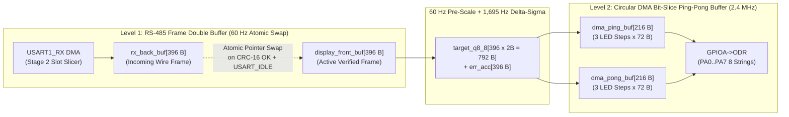

# Triangle Node MCU Firmware Architecture (`TriangleNode` v2.0)

**Component**: `TriangleNode` v2.0 Rigid-Flex / Modular PCB (Up to 850 Dual-Triangle Nodes / 1,700 Triangles across 70 RS-485 Chains)  
**Hardware Stack**:
- **MCU**: Puya `PY32F003F18U6` (`U1`, 32-bit ARM Cortex-M0+ @ $24.0\text{ MHz}$ or $32.0\text{ MHz}$ internal HSI, $64\text{ kB}$ Flash, $8\text{ kB}$ SRAM, `QFN-20` $3\times 3\text{ mm}$)
- **LED Array**: **132× Addressable 1010 RGB LEDs** (`TZ-H1010` / `XL-1010RGBC-WS2812B-S`, $2 \times 66$-LED base-11 triangles per node, partitioned across **8 parallel strings** `STR0..STR7` on `GPIOA[7:0]` via $330\,\Omega$ damping resistors `R1..R8`)
- **RS-485 Transceiver**: Texas Instruments `SN65176BDQ` (`U2`, `PB6` = `USART1_TX`, `PB7` = `USART1_RX`, `PB5` = `RS485_DE`)
- **Programming Header**: 6-pad no-legs pogo footprint `Tag-Connect TC2030-IDC-NL` (`J_SWD` on dedicated `PA13`/`PA14`/`PF2`)

---

## 1. Pinout & Hardware Resource Allocation (`TriangleNode` v2.0)

To enable **single-channel parallel DMA across all 8 LED strings simultaneously**, the entire low byte of `GPIOA` (`PA0..PA7`) is dedicated exclusively to the 8 LED data strings (`STR0..STR7`), while the RS-485 UART is placed on `GPIOB` (`PB5..PB7`) and SWD remains conflict-free on `PA13`/`PA14`:

```text
                       +------------------------------+
     USART1_RX / PB7   | 1 (AF0: From U2 RO)       20 | PB6 / USART1_TX (AF0: To U2 DI)
          PF0 / UNUSED | 2                         19 | PF4 / BOOT0 (10k R10 to GND + J_SWD)
          PF1 / UNUSED | 3                         18 | PF2 / NRST (10nF C40 to GND + J_SWD)
  LED_STR0_D1..17 / PA0| 4 (GPIOA Bit 0 -> R1)     17 | PA14 / SWCLK (Dedicated to TC2030 J_SWD)
 LED_STR1_D18..34 / PA1| 5 (GPIOA Bit 1 -> R2)     16 | PA13 / SWDIO (Dedicated to TC2030 J_SWD)
 LED_STR2_D35..50 / PA2| 6 (GPIOA Bit 2 -> R3)     15 | PA12 / NC
 LED_STR3_D51..66 / PA3| 7 (GPIOA Bit 3 -> R4)     14 | PA7 / LED_STR7_D117..132 (GPIOA Bit 7 -> R8)
                   GND | 8                         13 | PA6 / LED_STR6_D101..116 (GPIOA Bit 6 -> R7)
             +5.0V VDD | 9 (C1 10uF + C2 100nF)    12 | PA5 / LED_STR5_D84..100  (GPIOA Bit 5 -> R6)
 LED_STR4_D67..83 / PA4| 10 (GPIOA Bit 4 -> R5)    11 | PB5 / RS485_DE (To U2 DE & /RE, 10k R9 to GND)
                       +------------------------------+
```

### Hardware Peripheral Map:
| Peripheral | Assigned Task | Configuration |
| :--- | :--- | :--- |
| **`DMA_Channel1`** | **8-String Parallel WS2812 Waveform Generator** | Triggered by `TIM1_UP` at $2.40\text{ MHz}$ ($3 \times 800\text{ kHz}$); transfers 8-bit bit-sliced bytes from SRAM to `(uint8_t *)&GPIOA->ODR` (`0x50000014`). |
| **`DMA_Channel2`** | **RS-485 `Chain-Train` Two-Stage Slot Slicer** | Triggered by `USART1_RX`; Stage 1 discards upstream nodes (`MINC = 0`), Stage 2 captures this node's slot (`MINC = 1`). |
| **`DMA_Channel3`** | **RS-485 Upstream Telemetry / Discovery TX** | Triggered by `USART1_TX`; streams 10-byte `RSP_TELEMETRY` or 17-byte `RSP_DISC_UID` packets. |
| **`TIM1`** | **WS2812 Bit-Slice Timebase + HSI Auto-Baud** | Generates the $416.7\text{ ns}$ ($2.40\text{ MHz}$) DMA request ticks for `GPIOA->ODR`; Input Capture measures the `0x55` RS-485 preamble to trim HSI drift. |
| **`TIM14`** | **Microsecond Protocol Turnaround Timer** | Times the $15\,\mu\text{s}$ telemetry turnaround delay and Slotted-Aloha random backoff slots. |
| **`ADC1`** | **Die Temperature & Local $+5\text{V}$ Supply Sense** | Samples internal `ADC_IN11` (`TSensor`) and `ADC_IN12` (`VREFINT = 1.20V`) at $10\text{ Hz}$ in the background loop. |

---

## 2. Parallel 8-String WS2812/1010 DMA Engine

### 2.1 Why 8 Parallel Strings on `GPIOA[7:0]`?
Each 1010 addressable RGB LED uses an $800\text{ kHz}$ single-wire RZ protocol ($1.25\,\mu\text{s/bit} \times 24\text{ bits} = 30.0\,\mu\text{s/LED}$).
- If all 132 LEDs on a Dual-Triangle Node were wired as 1 long serial chain, a single refresh cycle would take $132 \times 30\,\mu\text{s} + 80\,\mu\text{s} = 4,040\,\mu\text{s}$ ($247\text{ Hz}$)—far too slow for temporal dithering.
- By splitting the 132 LEDs across **8 parallel strings (`PA0..PA7`, max $N_{\max} = 17\text{ LEDs/string}$)**:
  $$T_{\text{active}} = 17\text{ LEDs} \times 24\text{ bits} \times 1.25\,\mu\text{s} = \mathbf{510.0\,\mu\text{s}}$$
  Adding an $80\,\mu\text{s}$ reset/latch low interval yields a total subframe period of **$590.0\,\mu\text{s}$**, corresponding to a **$1,695\text{ Hz}$ hardware refresh rate**!
- Because the `PY32F003` has only 3 DMA channels total and each DMA channel can only write to a single peripheral register address (`GPIOA->ODR`), placing all 8 strings on `PA0..PA7` allows **1 single DMA channel (`DMA_Channel1`)** to drive all 8 strings simultaneously with zero disturb to `GPIOB` or `SWD`!

### 2.2 Three-Phase `GPIOA->ODR` Waveform Generation (`2.40 MHz` DMA)
Every $1.25\,\mu\text{s}$ ($800\text{ kHz}$) WS2812 bit period is divided into **3 equal time phases of $416.7\text{ ns}$** ($10\text{ CPU clock cycles}$ at $24.0\text{ MHz}$):

```text
Time within 1.25 us bit:   0 ns              416.7 ns           833.3 ns          1250.0 ns
                            |--- Phase 0 ---|--- Phase 1 ---|--- Phase 2 ---|
GPIOA->ODR Write:                0xFF          data_byte[b]        0x00
                            _________________
'0' Bit Waveform (T0H=417ns):                |_________________________________
                            ___________________________________
'1' Bit Waveform (T1H=833ns):                                  |_______________
```

- **Phase 0 ($0..417\text{ ns}$)**: `DMA_Channel1` writes `0xFF` to `(uint8_t*)&GPIOA->ODR`, driving all 8 strings (`PA0..PA7`) HIGH.
- **Phase 1 ($417..833\text{ ns}$)**: `DMA_Channel1` writes `data_byte[b]`, where bit $s \in \{0..7\}$ is the current bit value (`0` or `1`) for String $s$. Strings sending a `'0'` fall LOW at $416.7\text{ ns}$ ($T_{0H} = 417\text{ ns}, T_{0L} = 833\text{ ns}$); strings sending a `'1'` remain HIGH.
- **Phase 2 ($833..1250\text{ ns}$)**: `DMA_Channel1` writes `0x00`, driving all 8 strings LOW ($T_{1H} = 833\text{ ns}, T_{1L} = 417\text{ ns}$).
- Both timing waveforms sit squarely in the center of the `TZ-H1010` / `XL-1010RGBC-WS2812B-S` datasheet window ($T_{0H} = 300–450\text{ ns}$, $T_{1H} = 750–1000\text{ ns}$) with **zero interrupt jitter** because the DMA engine is clocked directly by `TIM1`.

### 2.3 Fast $8\times 8$ Bit-Slice Transposition Routine
To prepare `data_byte[b]` for Phase 1, the CPU takes 1 byte (`G`, `R`, or `B`) from each of the 8 strings (`s0..s7`) and transposes their bits so that Bit 7 (MSB) of all 8 strings forms the first `GPIOA->ODR` data byte, Bit 6 forms the second, down to Bit 0. Using a 32-bit SWAR (SIMD Within A Register) byte-interleave or unrolled shift-merge on Cortex-M0+, transposing 8 bytes takes only ~48 clock cycles ($2.0\,\mu\text{s}$ per color channel across all 8 strings = $102\,\mu\text{s}$ for all 17 LED steps, leaving **$>80\%$ CPU idle headroom**!).

---

## 3. High-Rate ($1,695\text{ Hz}$) Delta-Sigma ($\Delta\Sigma$) Temporal Dimming

### 3.1 The Low-Brightness Bit-Depth Crisis Under a $240\text{W}$ Power Envelope
At full 24-bit white `(255, 255, 255)`, 112,200 LEDs would draw $>8\text{ kW}$. Under a $240\text{W}$ USB-PD 3.1 EPR power bank, if all LEDs on the jacket are illuminated simultaneously, average LED power must be scaled down to **$2.54\%$ duty cycle** (`GLOB_SCALE = 6 / 255`):
- **Why Naive 8-Bit Static Scaling Fails**: Multiplying an 8-bit color channel by $0.0254$ before sending it to the LED ($\lfloor C \times 0.0254 \rfloor$) crushes the entire $0..255$ dynamic range into just **7 integer steps (`0..6`)**—reducing color depth to **$2.6\text{ bits/channel}$ ($343\text{ total colors}$)** and destroying smooth gradients and dark gamma curves.
- **Why Macro On/Off Subframe Blanking Fails Physically**: One might consider sending the unscaled 8-bit value `(R, G, B)` for 1 subframe ($590\,\mu\text{s}$) and `(0, 0, 0)` for the next 38 subframes ($22.4\text{ ms}$). **This fails catastrophically on addressable 1010 LEDs** because:
  1. The `TZ-H1010` / `XL-1010RGBC` contains a **free-running, asynchronous internal PWM oscillator ($f_{\text{PWM}} \approx 1.0–1.5\text{ kHz}$, period $667–1,000\,\mu\text{s}$)** whose phase does **not** reset when a new 24-bit frame latches.
  2. Gating a $1,000\,\mu\text{s}$ internal PWM cycle inside a $590\,\mu\text{s}$ macro ON window slices the internal PWM period at a drifting beat frequency ($|1,695\text{ Hz} - 1,200\text{ Hz}|$), causing up to **$5.3:1$ brightness aliasing and crawling spatial shimmer** across the jacket!
  3. Furthermore, flashing $100\%$ peak current once every $23\text{ ms}$ ($43.5\text{ Hz}$) causes severe **saccadic phantom-array strobe trails** when the wearer dances and causes massive $43\text{ Hz}$ current ripple on the $+5\text{V}$ rail.

### 3.2 The Solution: $1,695\text{ Hz}$ First-Order Delta-Sigma ($\Delta\Sigma$) Dithering
Instead of macro on/off blanking, each `TriangleNode` runs a **First-Order Delta-Sigma ($\Delta\Sigma$) Modulator (Bresenham Error Diffusion)** on every individual LED color channel at the full **$1,695\text{ Hz}$ ($590\,\mu\text{s}$) subframe rate**:

1. **16-Bit High-Precision Target Calculation (`On RS-485 Frame Latch, 60 Hz`)**:
   When a new RS-485 video frame latches, each LED's 8-bit channel $C \in \{0..255\}$ (or `RGB565` channel) is mapped through a 16-bit perceptual gamma table `gamma_q8_8[C]` (`0x0000..0xFF00`) and multiplied by the effective brightness scale (`eff_scale = GLOB_SCALE * local_thermal_scale`):
   ```c
   // Computed once per 60 Hz video frame (16.67 ms) for each of the 396 channels:
   target_q8_8[ch] = (uint16_t)((gamma_q8_8[raw_color[ch]] * eff_scale) >> 8);
   ```
   Here, the upper 8 bits (`target_q8_8 >> 8`) represent the integer 8-bit PWM floor $N$, and the lower 8 bits (`target_q8_8 & 0xFF`) represent the **$\frac{1}{256}\text{th}$ fractional LSB remainder**!

2. **Per-Subframe $\Delta\Sigma$ Accumulation Loop (`Every 590 µs @ 1,695 Hz`)**:
   During each $590\,\mu\text{s}$ subframe, for every channel `ch`:
   ```c
   uint16_t sum   = target_q8_8[ch] + err_acc[ch]; // 16-bit target + 8-bit residual error
   uint8_t  out8  = (uint8_t)(sum >> 8);           // 8-bit integer value sent to 1010 LED
   err_acc[ch]    = (uint8_t)(sum & 0xFF);         // Fractional error carried to next 590 us subframe
   ```

3. **Why $\Delta\Sigma$ Eliminates Internal PWM Beat Aliasing**:
   - Notice that `out8` sent to the 1010 LED **never jumps between `255` and `0`**. Instead, it smoothly alternates by **at most $\pm 1\text{ LSB}$** between adjacent integers $N$ and $N+1$ (e.g., between `6` and `7`, or `0` and `1` at ultra-dim levels)!
   - Because the LED's internal 8-bit PWM comparator stays continuously active at $N$ and only nudges its duty cycle by $\frac{1}{255}$ ($0.39\%$) on a subset of subframes, the LED's free-running $1.2\text{ kHz}$ internal oscillator runs continuously without window truncation.
   - Any $\pm 1\text{ LSB}$ transition jitter is bounded to a tiny fraction of a single LSB and pushed up to $847\text{ Hz}$ by the $\Delta\Sigma$ noise-shaping transfer function $H(z) = 1 - z^{-1}$, where the human eye completely integrates it out—yielding **stepless 12-to-14-bit perceptual dimming**!

---

## 4. Two-Level Double Buffering Architecture

To guarantee **zero visual tearing** (no frame ever displayed half-old/half-new) and **zero DMA race conditions** within the `PY32F003`'s $8\text{ kB}$ (`8,192 Bytes`) SRAM, the firmware uses a **Two-Level Double Buffering** scheme:



### 4.1 Level 1: RS-485 Frame Double Buffer (`rx_back_buf` $\leftrightarrow$ `display_front_buf`)
- While the $1,695\text{ Hz}$ Delta-Sigma engine reads from `display_front_buf`, `DMA_Channel2` writes incoming RS-485 bytes for the *next* video frame into `rx_back_buf[396]`.
- At the end of the `Chain-Train` broadcast, when `USART_IDLE` fires:
  1. The ISR verifies that the 2-byte `CRC-16/CCITT` trailer matches the running CRC accumulator.
  2. If and only if `CRC-16` is valid, the pointers `rx_back_buf` and `display_front_buf` are swapped atomically, and `new_frame_latched = 1` triggers recomputation of `target_q8_8[396]`.
  3. If a bit error ever corrupts a frame on the RS-485 wire, `rx_back_buf` is silently discarded and the node continues smoothly dithering `display_front_buf` with zero glitch!

### 4.2 Level 2: DMA Bit-Slice Ping-Pong Buffer (`HTIF` / `TCIF` Circular Streaming)
- Each LED step across 8 strings requires $24\text{ bits} \times 3\text{ phases} = 72\text{ bytes}$ of `GPIOA->ODR` waveform data ($17\text{ steps} \times 72\text{ B} = 1,224\text{ B}$ per subframe).
- We can either allocate two full $1,224\text{ B}$ subframe buffers (`2,448 B` total) or use a **6-step circular Ping-Pong buffer (`432 Bytes` total: `Ping = 3 steps [216 B]`, `Pong = 3 steps [216 B]`)**:
  - `DMA_Channel1` runs in Circular Mode over `dma_ring_buf[432]`.
  - On the **Half-Transfer Interrupt (`HTIF`, every $90\,\mu\text{s}$)**, the CPU populates the next 3 LED steps into `Ping` while DMA clocks out `Pong`.
  - On the **Transfer-Complete Interrupt (`TCIF`, every $90\,\mu\text{s}$)**, the CPU populates the next 3 LED steps into `Pong` while DMA clocks out `Ping`.
  - After Step 16 finishes, `Ping`/`Pong` are zero-filled (`0x00`) for 3 steps ($90\,\mu\text{s}$ Latch/Reset low period), completing the $600\,\mu\text{s}$ ($1,667\text{ Hz}$) cycle with **zero timer restarts**!

### 4.3 Complete `PY32F003` SRAM Memory Budget (`8,192 Bytes` Available)
| Buffer / Structure | Size (Bytes) | Purpose |
| :--- | :---: | :--- |
| `rx_back_buf` + `display_front_buf` | $792\text{ B}$ ($2 \times 396\text{ B}$) | Double-buffered RS-485 video frame payloads (`132 LEDs x 3 B`). |
| `target_q8_8[396]` | $792\text{ B}$ | 16-bit (`Q8.8`) gamma-expanded & `GLOB_SCALE`-multiplied targets. |
| `err_acc[396]` | $396\text{ B}$ | 8-bit per-channel $\Delta\Sigma$ fractional error accumulators. |
| `dma_slice_buf_A` + `dma_slice_buf_B` | $2,448\text{ B}$ (or $432\text{ B}$ ring) | Full double-buffered $17\text{-step} \times 72\text{ B}$ `GPIOA->ODR` DMA buffers! |
| Call Stack + Protocol / ADC State | $1,024\text{ B}$ | Stack, CRC state, telemetry packet, and commissioning variables. |
| **Total SRAM Used** | **$5,452\text{ B}$ ($66.5\%$)** | **Leaves $2,740\text{ Bytes}$ ($33.5\%$) of free SRAM margin!** |

---

## 5. Display Data Reception & Temperature Telemetry Protocol

*(Full wire-level byte tables are also detailed in [`RS485_PROTOCOL_PLAN.md`](./RS485_PROTOCOL_PLAN.md)).*

### 5.1 Downstream "Chain-Train" Slot Slicing (Two-Stage `USART1_RX` DMA)
Every `Chain-Train` video broadcast on a chain begins with a 4-byte header (`0x55`, `CMD_FRAME_DATA`, `GLOB_SCALE`, `POLL_CFG`), followed by concatenated node payloads (`Node 0`, `Node 1`, ..., `Node K-1`), and ends with a 2-byte `CRC-16/CCITT` trailer and a $\ge 16\text{ bit-time}$ idle break:
1. **HSI Auto-Baud Calibration on Byte 0 (`0x55`)**:
   - The `PY32F003` runs on its internal RC oscillator (`HSI`), which can drift by $\pm 2\%$ as the jacket heats up from $20^\circ\text{C}$ to $75^\circ\text{C}$.
   - `TIM1` captures the exact clock-cycle width of the alternating `0x55` (`01010101b`) preamble byte on every frame and updates `USART1->BRR` dynamically, keeping the baud rate locked to the FPGA within **$< 0.1\%$** across all temperatures!
2. **Two-Stage DMA Offset Slicer**:
   - A node at chain slot $k > 0$ does not waste SRAM buffering upstream nodes $0 .. k-1$:
     - **Stage 1 (Discard Upstream Bytes)**: `DMA_Channel2` is configured with Memory Increment **DISABLED** (`MINC = 0`), writing the $k \times B_{\text{node}}$ upstream bytes into a single dummy byte `rx_throwaway_byte`.
     - **Stage 2 (Capture Own Slot)**: In the 12-cycle Stage 1 `DMA_TC` ISR, the CPU enables `MINC = 1`, points `CMAR` to `rx_back_buf`, and captures its exact $B_{\text{node}}$ bytes ($396\text{ B}$ in `RGB888`, or $264\text{ B}$ in `RGB565`).
     - **Stage 3 (Discard Downstream Bytes)**: `MINC = 0` is restored until `USART_IDLE` fires to latch the frame globally.

### 5.2 Returning Piggybacked Temperature & Voltage Telemetry (`RSP_TELEMETRY = 0x81`)
- **Supply-Independent Die Temperature & Dynamic Rail Voltage Measurement ($3.5\text{V}–5.0\text{V}$)**:
  - Because `TriangleNode` v2.0 powers both the `PY32F003` MCU and the 132 addressable 1010 RGB LEDs directly from the variable buck supply rail ($V_{DD} \in [3.50\text{V}, 5.00\text{V}]$, which experiences load-dependent cable IR-drop), raw ADC counts cannot rely on an assumed fixed $+5.0\text{V}$ reference.
  - Instead, the 12-bit ADC continuously references the MCU's internal **$1.20\text{V}$ bandgap reference (`ADC_IN12 = VREFINT`)**:
    $$V_{DD,\text{mV}} = \frac{1200 \times 4095}{\text{ADC}_{\text{VREFINT}}}, \qquad V_{\text{TSense,mV}} = \frac{\text{ADC}_{\text{CH11}} \times 1200}{\text{ADC}_{\text{VREFINT}}}$$
    This provides high-accuracy, supply-independent voltage monitoring ($20\text{ mV}$ resolution) and die temperature measurements ($0.5^\circ\text{C}$ resolution) across the entire dynamic $3.5\text{V}–5.0\text{V}$ operating range with **zero external voltage dividers or precision thermistors**.
- **Tail-Node Headroom & Dynamic Voltage Scaling (DVS) Support**:
  - **Tail-Node Self-Awareness**: During commissioning, each node records its assigned `slot_id` ($k$) and the total chain length ($K$). If $k == K-1$, the node sets an internal flag `is_tail_node = 1`.
  - **Under-Voltage Warning (`UV_WARN`)**: If local $V_{DD}$ sags below $3.40\text{V}$ (approaching the compliance dropout knee of the Blue LED linear drivers at $3.1\text{V} + 0.3\text{V}$), the node immediately sets the `UV_WARN` flag (Bit 6) in its telemetry status byte.
  - **Linear Driver Heat Elimination**: Operating at $3.5\text{V}–3.8\text{V}$ eliminates over $55\%$ of waste heat in the 1010 LED packages compared to fixed 5.0V operation. Because both the `PY32F003` logic and the 1010 internal control ICs are powered from the same rail, $V_{OH} \approx V_{DD}$ and $V_{IH} \approx 0.7 V_{DD}$ track each other symmetrically, guaranteeing robust WS2812 signal integrity down to $3.5\text{V}$.
- **Piggybacked Response Format (10 Bytes)**:
  - If `POLL_CFG` in the `Chain-Train` header has `POLL_EN == 1` (Bit 7) and `POLL_SLOT == my_slot_id` (Bits `6:0`), this node waits $15\,\mu\text{s}$ after `USART_IDLE`, asserts `RS485_DE = 1` (`PB5`), and transmits via DMA:
    - `Byte 0`: `0x55` (Preamble / Sync)
    - `Byte 1`: `0x81` (`RSP_TELEMETRY`)
    - `Byte 2`: `my_slot_id` ($0\dots 26$)
    - `Byte 3`: `STATUS_FLAGS` (Bit 7 = `IS_TAIL_NODE`, Bit 6 = `UV_WARN`, Bit 5 = `OTP_WARN`, Bits 4:0 = `ERR_COUNT`)
    - `Byte 4`: `TEMP_HALF_C` (Die temp: $\text{deg C} = \text{val} \times 0.5 - 20$)
    - `Byte 5`: `VDD_20MV` (Local rail: $V_{\text{node,mV}} = 2800 + \text{val} \times 20$, covering $2.80\text{V}–5.50\text{V}$)
    - `Byte 6..7`: `PEAK_SAG_MV` (Maximum recorded $V_{\text{sag}} = V_{\text{idle}} - V_{\text{load}}$ on this frame in mV)
    - `Byte 8..9`: `CRC-16/CCITT` over Bytes 0..7
  - Releases `RS485_DE = 0` within $33.3\,\mu\text{s}$, well inside the $150\,\mu\text{s}$ inter-frame blanking window.

---

## 6. Aloha Discovery Sequence & Chain Ordering by Visual Confirmation

Every `TriangleNode` is flashed with **identical firmware** (`slot_id = 0xFF` unconfigured). Commissioning a newly assembled jacket (or replacing a damaged node) happens in **three automated phases**:

### Phase 1: Electronic Slotted-Aloha + Binary-Tree 96-bit `UID` Discovery (`< 2.5 Seconds` Whole Jacket)
1. The FPGA broadcasts `CMD_DISC_SLOTS (0x10, num_slots = 64, prefix_len = 0)` on all 70 chains in parallel.
2. Each undiscovered node (`slot_id == 0xFF`) reads its factory 96-bit silicon `UID` (`0x1FFF0E00`), computes `CRC32(UID)`, and picks a random time slot $s = \text{CRC32}(\text{UID}) \bmod 64$ ($100\,\mu\text{s}$ per slot).
3. In slot $s$, the node transmits its **17-byte `RSP_DISC_UID (0x90)` packet** containing its 96-bit `UID`, unloaded $+5\text{V}$ reading, and temperature.
4. For every clean `CRC-16` reply received by the FPGA, the FPGA immediately issues `CMD_DISC_MUTE (0x11, UID_96)`, silencing that node for the remainder of the pass.
5. Any remaining nodes that collided in the same slot are resolved in 1–2 rounds via changing `round_seed` or binary-tree prefix masking (`prefix_len`, `prefix_val`). All ~27 nodes per chain are discovered in **$< 35\text{ ms/chain}$** ($< 2.5\text{ s}$ across all 70 chains!).

### Phase 2: Automatic Electrical $+5\text{V}$ IR-Drop Pre-Sorting + Interactive Visual Confirmation
Once the FPGA knows the set of 96-bit `UID`s on Chain $c$, how does it determine their physical daisy-chain order `Slot 0, Slot 1, ..., Slot K-1`?

1. **Automated Pre-Sort via $+5\text{V}$ Cable IR-Drop Gradient (`CMD_IR_DROP_TEST = 0x13`)**:
   - The FPGA commands the farthest candidate node to turn on all 132 LEDs at $50\%$ white for $5\text{ ms}$ (~$1.5\text{A}$ load) while every node on the chain samples its local $V_{DD}$ via `VREFINT`.
   - Because current flows through the ribbon cable resistance from Node $0 \rightarrow 1 \rightarrow \dots \rightarrow K-1$, the measured voltage sag $\Delta V_i = V_{\text{idle},i} - V_{\text{load},i}$ increases monotonically along the chain:
     $$\Delta V_{\text{Slot 0}} < \Delta V_{\text{Slot 1}} < \dots < \Delta V_{\text{Slot } K-1}$$
   - Sorting the discovered `UID`s by $\Delta V_i$ automatically puts the chain into ~95–100% correct order in $< 100\text{ ms}$!
2. **Visual Confirmation & Ordering Along the Chain (Two Fast Operator Modes)**:
   - **Mode A — Interactive Visual Chase Confirmation (Default after IR-Drop Pre-Sort)**:
     - The FPGA assigns provisional `slot_id = 0 .. K-1` from the IR-Drop sort and runs a smooth **Visual Chase Sweep** (`Slot 0 -> Slot 1 -> ... -> Slot K-1` lighting up in bright Cyan while the rest of the chain is dim Blue).
     - The operator watches the chase flow along the garment seam. If all nodes light in physical sequence, the operator taps **"Confirm Chain"** on the phone app (takes **3 seconds per chain**!).
     - If two adjacent nodes (`Slot m` and `Slot m+1`) light out of order, the operator taps **"Swap m / m+1"** in the UI (or enters **6-Color Block Mode**, where 6 nodes at a time light in `Red`, `Green`, `Blue`, `Yellow`, `Cyan`, `Magenta` and the user taps the color buttons in physical order along the seam).
   - **Mode B — Smartphone Camera Temporal Gray-Code Auto-Mapper (Hands-Free Whole Jacket)**:
     - Each discovered node flashes a unique 11-bit temporal Manchester/Gray-code pattern over 22 frames ($0.73\text{ s}$). Pointing the phone camera at the Front, Back, Left, and Right of the jacket automatically locates every `(x, y)` triangle and assigns every `slot_id` across all 70 chains in $< 30\text{ seconds}$!
3. **Committing to Non-Volatile Flash (`CMD_ASSIGN_SLOT = 0x12`)**:
   - Once confirmed, the FPGA sends `CMD_ASSIGN_SLOT (0x12, UID_96, assigned_slot_id, chain_id)`. Each node writes its `slot_id` and `CRC-16` signature into its dedicated Flash user configuration page (`0x0800FC00`).

### Phase 3: Single-Node "Pigeonhole Auto-Heal" on Field Repair
If a single damaged `TriangleNode` on Chain $c$ (say, Slot 5) is ever replaced in the field with a fresh factory spare (`slot_id = 0xFF`):
- At power-on, the FPGA polls Slots $0 .. K-1$ on Chain $c$ and sees that all slots *except* Slot 5 reply, while an unconfigured `UID` responds to `CMD_DISC_SLOTS`.
- By the **Pigeonhole Principle**, the single new node on Chain $c$ *must* belong to the single missing slot (`Slot 5`)! The FPGA automatically issues `CMD_ASSIGN_SLOT(UID_new, slot_id = 5)` and heals the jacket in **$< 50\text{ ms}$ with zero human intervention**.

---

## 7. Factory Assembly Flashing & Automated Testing Plan

When 850–1,800 `TriangleNode` boards are manufactured at the PCBA factory, every single board must be **flashed, optically verified, and electrically load-tested** in a fast, foolproof assembly-line workflow.

### Step 1: Pogo-Jig SWD Flashing via `Tag-Connect TC2030-IDC-NL` (`< 1.5 Seconds / Board`)
- **Zero Per-Node Firmware Customization**: Every `TriangleNode` is flashed with the **exact same `triangle_node_v2.bin` image**.
- **Fixture**: A spring-loaded clam-shell pogo jig mates with:
  1. The 6-pad no-legs **`Tag-Connect TC2030-IDC-NL` (`J_SWD`)** footprint (`PA13 = SWDIO`, `PA14 = SWCLK`, `PF2 = NRST`, `VCC`, `GND`).
  2. The 4-pad input edge (`+5V`, `GND`, `RS485_A`, `RS485_B`).
- Because `PA13` and `PA14` are 100% dedicated to SWD (never shared with LEDs or RS-485), the programmer (`CMSIS-DAP` / `ST-Link` / gang flasher) connects immediately without requiring a cold-reset timing dance, erases/programs the $12\text{ kB}$ image, and verifies Flash CRC in **$< 1.5\text{ seconds}$**.

### Step 2: Autonomous Power-On Bench Self-Test (When No RS-485 Host is Connected)
What if a technician at the SMT rework station simply clips $+5\text{V}$ and `GND` onto a board to check if all 132 LEDs are soldered properly?
- **2-Second No-Bus Watchdog Trigger**:
  - If a `TriangleNode` boots up with `slot_id == 0xFF` (uncommissioned factory state) and detects **zero RS-485 bytes on `USART1_RX` for $2.0\text{ seconds}$**, it automatically enters **Standalone SMT Bench Self-Test Mode** (and exits immediately the microsecond any `0x55` RS-485 sync byte arrives!).
- **Visual SMT Defect Pattern**:
  - Loops a smooth, eye-safe **$10\%$ brightness ($25/255$) chase** across `STR0..STR7` (`Red -> Green -> Blue -> Dim White`), allowing a human inspector to immediately spot:
    - A tombstoned or reversed 1010 LED (string stops lighting past LED $m$).
    - An open $330\,\Omega$ damping resistor `R1..R8` (one of the 8 strings is completely dark).
    - A dead R, G, or B die inside any 1010 package.

### Step 3: Automated Factory QC Sequence via `CMD_TEST_MODE (0x20)` (`4.5 Seconds / Board or Full Chain`)
Immediately after SWD flashing in the test jig (or across an entire assembled garment chain), the test fixture sends the broadcast command **`CMD_TEST_MODE (0x20)`**:

| Test Phase | Duration | Visual / Electrical Action | Defect Caught |
| :--- | :---: | :--- | :--- |
| **Phase 1: Solid Red** | $0.5\text{ s}$ | All 132 LEDs driven to `(R = GLOB_SCALE, G = 0, B = 0)` | Dead Red LED dies; Red channel shorts. |
| **Phase 2: Solid Blue** | $0.5\text{ s}$ | All 132 LEDs driven to `(R = 0, G = 0, B = GLOB_SCALE)` | Dead Blue LED dies (highest $V_F \approx 3.1\text{V}$ die). |
| **Phase 3: Solid Green** | $0.5\text{ s}$ | All 132 LEDs driven to `(R = 0, G = GLOB_SCALE, B = 0)` | Dead Green LED dies; solder bridges between adjacent pins. |
| **Phase 4: White Ramp & Peak Stress** | $3.0\text{ s}$ | Smooth Delta-Sigma cosine ramp `(0,0,0) -> (Max,Max,Max) -> (0,0,0)` across all 132 LEDs | Cold power joints, decoupling capacitor defects, thermal hotspots, and $\Delta\Sigma$ engine verification. |
| **Phase 5: Automated Pass/Fail Telemetry Report** | $< 1\text{ ms}$ | At the $t = 1.5\text{ s}$ peak of the White Ramp, the node samples its loaded supply rail $V_{DD,\text{load}}$ and peak die temperature $T_{\text{peak}}$, compares them against unloaded $V_{DD,\text{idle}}$, and returns `RSP_TELEMETRY (0x81)` to the jig. | **Automatic Pass/Fail Criteria in Jig**:<br>1. **96-bit UID & RS-485 Transceiver**: Verified by valid `CRC-16` reply.<br>2. **Power Rail Sag ($\Delta V = V_{\text{idle}} - V_{\text{load}}$)**: Must fall within expected current window (flags shorted caps or open LED strings).<br>3. **Die Temperature ($T_{\text{peak}}$)**: Must be $< 55^\circ\text{C}$ after $3\text{ s}$ ramp (flags shorted GPIO pins or damaged LDO/MCU). |
